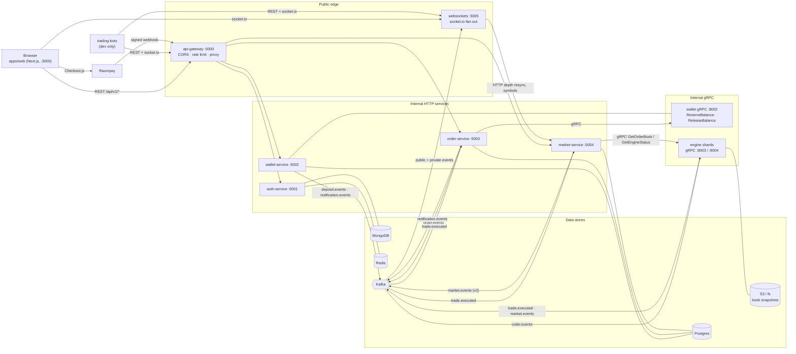
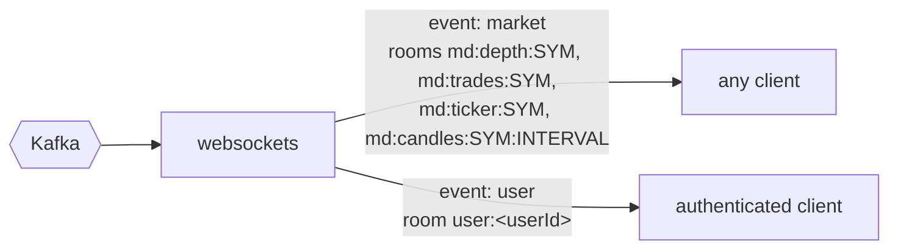
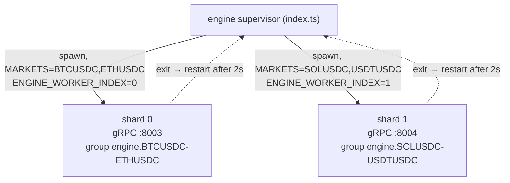
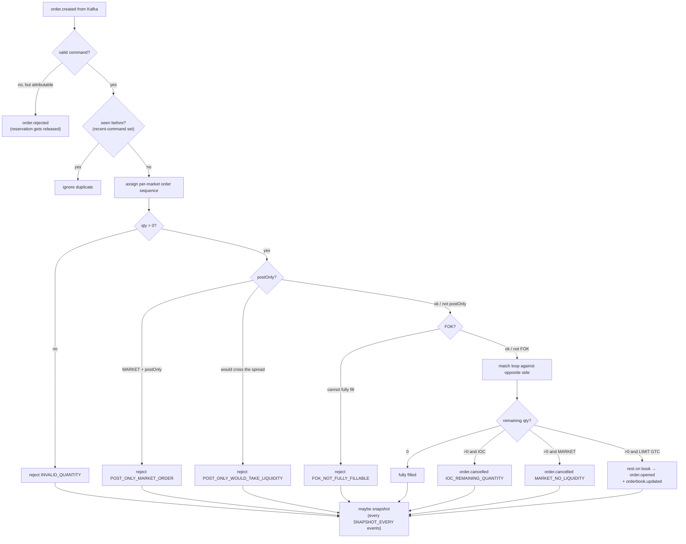
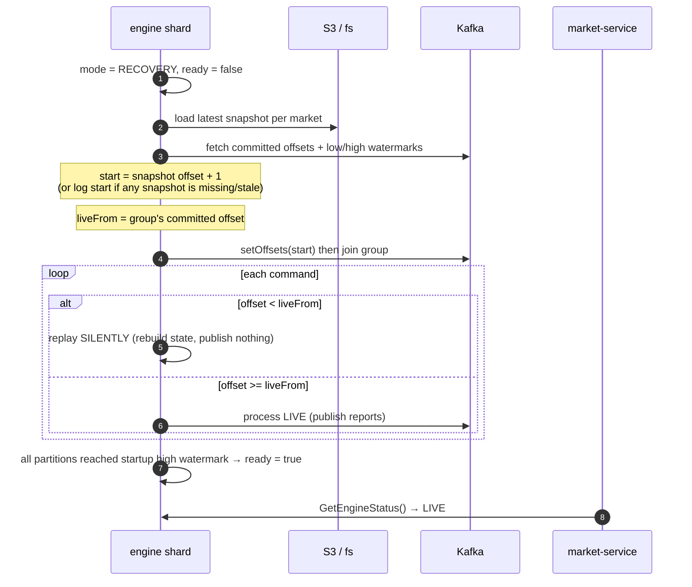
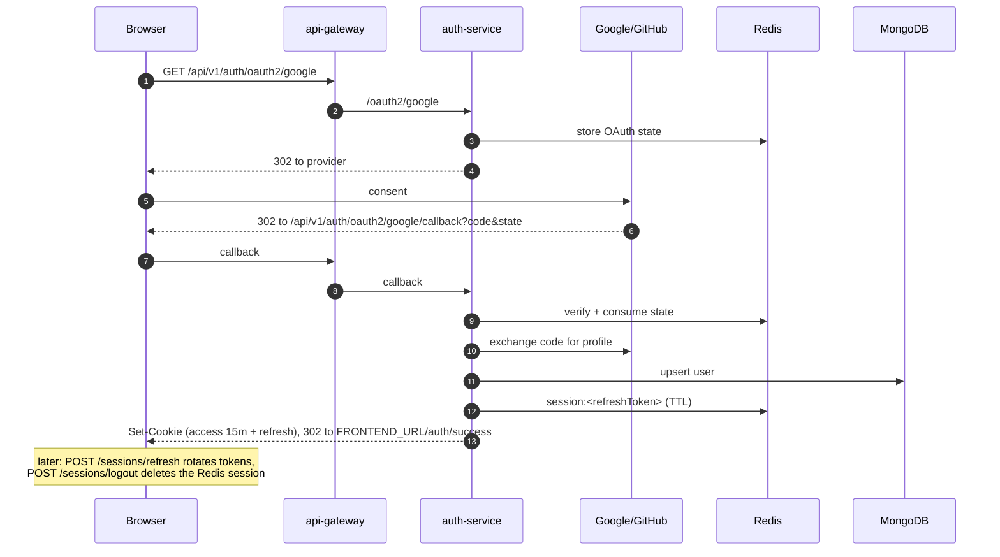
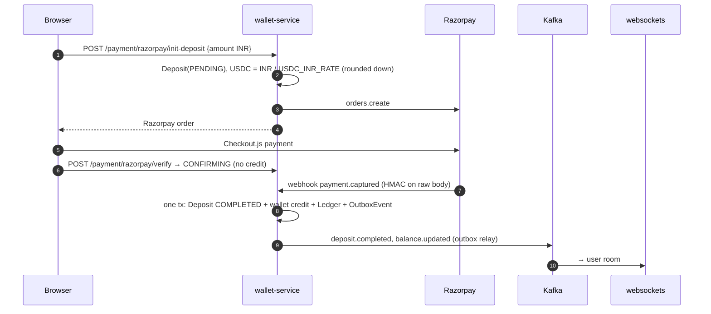
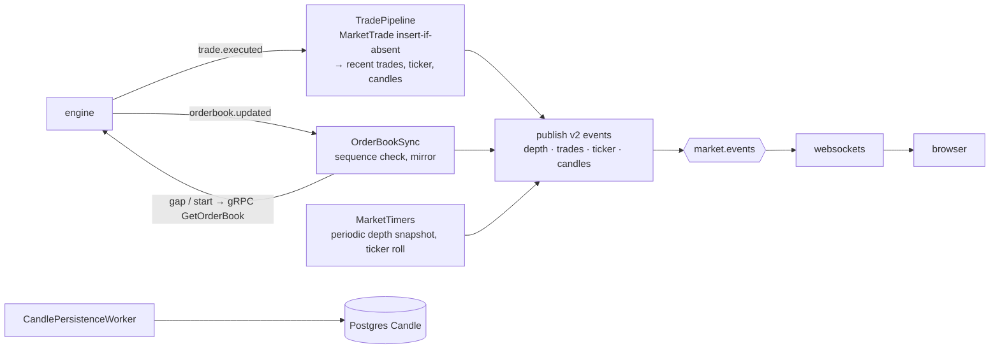

# Aurax

Aurax is a crypto spot exchange built as a set of microservices. Users sign in
with Google or GitHub, deposit INR through Razorpay (credited as USDC), and
trade spot markets (`BTCUSDC`, `ETHUSDC`, `SOLUSDC`, `USDTUSDC`) against an
in-memory price-time matching engine. Market data and account updates stream
to the browser in real time.

It is a Bun + TypeScript monorepo managed with Turborepo.

---

## Table of contents

1. [High-level architecture](#1-high-level-architecture)
2. [Repository layout](#2-repository-layout)
3. [Services](#3-services)
4. [How services communicate](#4-how-services-communicate)
5. [The matching engine](#5-the-matching-engine)
6. [End-to-end flows](#6-end-to-end-flows)
7. [Data model and sources of truth](#7-data-model-and-sources-of-truth)
8. [Reliability: idempotency, outbox, recovery](#8-reliability-idempotency-outbox-recovery)
9. [Running locally](#9-running-locally)
10. [Testing](#10-testing)
11. [Further docs](#11-further-docs)

---

## 1. High-level architecture



Core ideas:

- **Two public entry points only.** The browser talks to `api-gateway` (REST)
  and `websockets` (socket.io). Everything else (services, gRPC, Kafka, data
  stores) is internal.
- **Commands go in through Kafka, results come out through Kafka.** The
  order-service never calls the engine directly. It writes an `order.created`
  command, and the engine publishes execution reports that other services
  consume.
- **Money lives in Postgres and is moved only inside DB transactions.** The
  engine only matches. It never touches balances. Settlement happens in
  order-service.
- **Every event has a deterministic id and every consumer is idempotent.**
  Kafka is at-least-once, so duplicates are expected and handled.

---

## 2. Repository layout

```
aurax/
├── apps/
│   ├── api-gateway/      Express reverse proxy, CORS, per-IP rate limits
│   ├── auth-service/     Google/GitHub OAuth, JWT access + refresh sessions
│   ├── wallet-service/   Balances, reservations (gRPC), Razorpay deposits, ledger
│   ├── order-service/    Order intake, cancel, history, trade settlement
│   ├── engine/           In-memory matching engine, sharded by market
│   ├── market-service/   Markets, tickers, depth, public trades, candles
│   ├── websockets/       socket.io gateway for public + private streams
│   ├── web/              Next.js frontend (Redux, Tailwind, socket.io-client)
│   └── trading-bots/     Dev-only bot lab that trades against the real stack
├── packages/
│   ├── core/             Shared REST helpers, JWT verify, request validation
│   ├── grpc/             .proto files, generated types, client/server helpers
│   ├── kafka/            kafkajs client, producer, topic names
│   ├── postgres/         Prisma schema, migrations, seed, outbox relay (@repo/pg)
│   ├── mongodb/          Mongoose connection + User model
│   ├── redis/            Redis client + typed string/set helpers
│   ├── logger/           Shared pino logger
│   ├── eslint-config/    Shared ESLint config
│   └── typescript-config/Shared tsconfig presets
├── scripts/              Kafka topic creation
├── docs/                 Detailed API, event and integration docs
└── docker-compose.yml    Redis, MongoDB, Postgres, Kafka (KRaft)
```

---

## 3. Services

| Service | Port | Stores | Responsibility | Does **not** do |
|---|---|---|---|---|
| **api-gateway** | 5000 | — | CORS, global + write rate limits, routes `/api/v1/{auth,wallet,order,market}` to services, JSON 502/504 on upstream failure | Verify JWTs (each service verifies its own) |
| **auth-service** | 5001 | MongoDB (users), Redis (sessions, OAuth state, user cache) | Google/GitHub OAuth, issues a 15-minute access JWT plus a refresh session, refresh, logout, profile | Balances, trading |
| **wallet-service** | 5002 HTTP, 8002 gRPC | Postgres | Wallet balances, `ReserveBalance` / `ReleaseBalance` over gRPC, Razorpay INR to USDC deposits, deposit and ledger history | Matching, settlement |
| **order-service** | 5003 | Postgres | Validates orders against market rules, reserves funds, persists orders, publishes engine commands, **settles trades**, order and fill history | Matching |
| **engine** | 8003, 8004 gRPC | Memory + snapshots on S3/fs | Price-time priority matching per market, one process per shard | Persisting orders or touching balances |
| **market-service** | 5004 | Postgres + memory | Mirrors the book, builds tickers, candles and public trades, publishes v2 market-data events, REST market endpoints | Private data |
| **websockets** | 5005 | — | Public market channels and each user's own private events | Accepting writes |
| **web** | 3000 | — | Next.js trading UI | — |
| **trading-bots** | — | Mongo/Postgres (provisioning only) | Dev-only market makers and takers that use the public API | Ever running in production |

### REST surface (through the gateway)

| Prefix | Main endpoints |
|---|---|
| `/api/v1/auth` | `GET /oauth2/{google,github}`, `/oauth2/*/callback`, `POST /sessions/refresh`, `POST /sessions/logout`, `GET /details` |
| `/api/v1/wallet` | `GET /assets`, `/deposits`, `/deposits/:id`, `/ledger`, `GET /payment/razorpay/quote`, `POST /payment/razorpay/init-deposit`, `POST /payment/razorpay/verify`, `POST /webhook/razorpay` |
| `/api/v1/order` | `POST /`, `GET /`, `GET /trades`, `GET /:orderId`, `DELETE /:orderId` |
| `/api/v1/market` | `GET /markets`, `/tickers`, `/markets/:symbol`, `.../orderbook`, `.../ticker`, `.../bookTicker`, `.../price`, `.../candles`, `.../trades`, `.../historical-trades` |

The gateway strips the mount path, so `/api/v1/order/abc` reaches
order-service as `/abc`.

---

## 4. How services communicate

Three transports are used, each for a specific job.

### 4.1 Synchronous HTTP (request/response)

`Browser → api-gateway → service`. This covers reads and user commands that
need an immediate answer, such as "order accepted" or "deposit created". The
gateway is a plain proxy (`http-proxy-middleware`). Auth is checked by each
downstream service with the shared `JWT_ACCESS_SECRET`.

`websockets → market-service` (direct HTTP, not through the gateway) is used
to fetch a fresh depth snapshot when a client needs a resync, and to get the
list of tradable symbols.

### 4.2 Synchronous gRPC (internal, low latency)

Defined in [`packages/grpc/proto`](packages/grpc/proto).

| Service | RPC | Caller | Purpose |
|---|---|---|---|
| `wallet.WalletService` (`:8002`) | `ReserveBalance(user_id, asset_symbol, amount, reference_id)` | order-service | Atomically move funds from available to locked before an order exists |
| | `ReleaseBalance(reference_id)` | order-service | Undo a reservation if the order could not be persisted |
| `order.MatchingEngine` (`:8003+i`) | `GetOrderBook(symbol)` | market-service | Seed or resync the book mirror |
| | `GetEngineStatus()` | market-service | Wait until the engine is `LIVE` (recovery finished) |

market-service routes per symbol to the right engine shard using
`ORDER_GRPC_URL=BTCUSDC,ETHUSDC=127.0.0.1:8003;SOLUSDC,USDTUSDC=127.0.0.1:8004`.

### 4.3 Asynchronous Kafka (events and commands)

| Topic | Carries | Key | Producer | Consumers |
|---|---|---|---|---|
| `order.events` | **Commands**: `order.created`, `order.cancel_requested` | symbol | order-service (outbox) | engine shards, websockets |
| `trade.executed` | **Execution reports**: `trade.executed`, `order.opened`, `order.cancelled`, `order.rejected`, `order.cancel_rejected` | symbol | engine | order-service, market-service, websockets |
| `market.events` | engine `orderbook.updated` (full book) and market-service `depth/trades/ticker/candles.updated` | symbol | engine, market-service | market-service (book), websockets |
| `deposit.events` | `deposit.completed` | userId | wallet-service (outbox) | websockets |
| `notification.events` | `balance.updated` | userId | wallet-service, order-service (outbox) | websockets |

The partition keys give the ordering each flow needs:

- `symbol` on `order.events` gives the engine **one total order of commands
  per market**, so replays are deterministic.
- `symbol` on `trade.executed` ensures a cancel can never overtake the fills
  that came before it.
- `userId` keeps one user's balance and deposit updates in order.

Consumer-group rules:

- Different services use different groups, so each one sees every event.
- Each engine shard has its own group (`engine.BTCUSDC-ETHUSDC`, ...).
- Replicas of a worker service (order-service, market-service) share a group,
  so each report is processed once.
- Each websockets instance uses a **per-instance** group, so every instance
  sees every event for its own connected sockets.

### 4.4 Real-time to the browser (socket.io)



- **Public**: clients send `{ action: "subscribe", channel, symbol, interval? }`
  for `depth`, `trades`, `ticker` or `candles` (`1m`, `5m`, `15m`, `1h`, `1d`).
  Depth uses snapshot, then incremental updates, and a `resync` when a
  sequence gap appears.
- **Private**: no subscription step. The socket's verified JWT puts it in
  `user:<userId>`, so a client can never ask for another user's events. It
  receives `order.accepted`, `order.opened`, `trade.executed`,
  `order.partially_filled`, `order.filled`, `order.cancelled`,
  `order.rejected`, `balance.updated` and `deposit.completed`.
- A missing or expired token does not drop the connection. The socket stays
  public-only and receives a `session` event that says why.

---

## 5. The matching engine

Code: [`apps/engine/src`](apps/engine/src).

### 5.1 Process model and sharding



- The supervisor reads `MARKETS_A` and `MARKETS_B` and spawns one **child
  process** per shard. If a shard crashes, it is restarted after 2 seconds.
  Child processes are used instead of `node:cluster` because each shard needs
  its own gRPC port, which `cluster` handles badly under Bun.
- Each shard loads its markets (precision) from Postgres, starts gRPC on
  `ENGINE_GRPC_BASE_PORT + index`, then consumes `order.events` with its own
  consumer group. Messages for symbols the shard does not own are skipped.
- **The engine is single-threaded per shard.** Commands for a market are
  processed strictly one at a time in Kafka order. This makes matching
  deterministic: the same input log always produces the same book and the
  same fills.

### 5.2 Order book data structure

`OrderBook` ([`orderbook/orderbook.ts`](apps/engine/src/orderbook/orderbook.ts)):

- `bids: Map<price, Order[]>` and `asks: Map<price, Order[]>`. Each price
  level is a FIFO array, which gives **time priority** within a price.
- `index: Map<orderId, Order>` for O(1) lookup on cancel.
- The best bid/ask is found by scanning the price keys, which is cheap for the
  number of levels a market has here.
- Quantities are rounded to the market's `quantityPrecision` after every
  operation, so float residue such as `0.3 - 0.1` never builds up.

### 5.3 What happens to one `order.created`



**Matching loop (price-time priority):**

```
while taker.remaining > 0:
    maker = best ask (if taker is BUY) or best bid (if SELL)
    if no maker, or price does not cross (LIMIT only): stop
    qty = min(taker.remaining, maker.remaining)
    execute at the MAKER's price
      → update both orders, remove maker if filled
      → publish trade.executed (tradeId = "<takerOrderId>-f<n>")
      → publish orderbook.updated (full book, new book sequence)
```

- Trades always execute at the **resting (maker) order's price**.
- `MARKET` orders cross at any price and never rest. Any unfilled remainder is
  cancelled. order-service rejects `MARKET` **buys** up front, because the
  engine cannot cap quote spend and the reservation could not be guaranteed.
- Supported options: `LIMIT` / `MARKET`, `GTC` / `IOC` / `FOK`, `postOnly`.

**Cancel (`order.cancel_requested`):** dedupe, look up by id, check the owner,
remove from the book, then publish `order.cancelled (USER_CANCELLED)` and a
new book. If the order is not on the book or the user is not the owner, it
publishes `order.cancel_rejected`.

### 5.4 Events the engine emits

| Event | Topic | Deterministic `eventId` |
|---|---|---|
| `order.opened` | `trade.executed` | `opened:<orderId>` |
| `trade.executed` (maker + taker status, executed/remaining qty, price, qty) | `trade.executed` | `trade:<takerOrderId>-f<n>` |
| `order.cancelled` | `trade.executed` | `cancelled:<orderId>` |
| `order.rejected` | `trade.executed` | `rejected:<orderId>` |
| `order.cancel_rejected` | `trade.executed` | `cancel-rejected:<orderId>` |
| `orderbook.updated` (all levels + `sequenceNumber`) | `market.events` | per-market book sequence |

All messages are sent with `acks: -1` (all in-sync replicas), GZIP, and
`key = symbol`.

### 5.5 Snapshots and crash recovery

The engine keeps the book in memory only. Durability comes from **the Kafka
command log plus periodic snapshots**.

- Every `SNAPSHOT_EVERY` (default 100) processed commands, a shard writes a
  snapshot of the market to S3 (or the local `fs` when `SNAPSHOT_STORE=fs`).
  The snapshot holds the resting orders, the book and order sequence numbers,
  the recent command ids (for dedupe), and the **Kafka partition/offset** of
  the last command it includes.

On startup, `consumeOrder` does the following:



- Commands **before** the committed offset were already processed and
  published before the crash, so they are replayed silently.
- Commands **at or after** it may not have been published, so they are
  replayed live. Because fill ids are deterministic (`<taker>-f<n>`), anything
  published twice is a no-op downstream.
- Edge cases are handled explicitly. A snapshot from an earlier Kafka
  incarnation (offset past the log end) is discarded and the book is rebuilt
  from the start. If retention deleted commands between the snapshot and the
  log start, the engine **refuses to start** rather than run with a wrong
  book.
- gRPC starts before recovery, so `GetEngineStatus` reports `RECOVERY` until
  the shard is caught up. market-service waits for `LIVE` before it serves
  data.

---

## 6. End-to-end flows

### 6.1 Sign in (OAuth)



Every service that needs auth verifies the access JWT locally with the shared
secret. No service calls auth-service per request.

### 6.2 Deposit (Razorpay INR to USDC)



**Only the signed webhook credits funds.** The client-side `verify` call can
never credit or downgrade a deposit.

### 6.3 Place an order (the main trading flow)

```mermaid
sequenceDiagram
  autonumber
  participant B as Browser
  participant G as api-gateway
  participant O as order-service
  participant W as wallet gRPC
  participant K as Kafka
  participant E as engine
  participant M as market-service
  participant S as websockets

  B->>G: POST /api/v1/order {symbol, side, orderType, price, quantity, timeInForce, postOnly}
  G->>O: POST /
  O->>O: validate tick/step size, min/max, min notional, market status
  O->>W: ReserveBalance(user, asset, amount, referenceId)
  W-->>O: ok (available → locked, one conditional UPDATE)
  O->>O: tx: Order(PENDING) + OutboxEvent(order.created)
  O-->>B: 202 Accepted {order, reserved}
  O->>K: order.events: order.created (outbox relay)
  K->>S: → "user" order.accepted
  K->>E: order.created
  E->>E: match
  E->>K: trade.executed / order.opened / order.cancelled / order.rejected
  E->>K: market.events: orderbook.updated
  K->>O: settle each fill exactly once (wallets, ledger, trades, outbox balance.updated)
  K->>M: trade → MarketTrade, ticker, candles; book → depth
  M->>K: market.events: depth/trades/ticker/candles.updated
  K->>S: public channels + private order/trade/balance events
  S-->>B: live updates
```

How much is reserved:

- **SELL**: the base quantity.
- **LIMIT BUY**: `price × quantity + max(makerFee, takerFee)`, rounded up to
  8 decimals. A better fill price or unused fee margin is released when the
  order fills or is cancelled.

`202 Accepted` only means "funds reserved and command queued". The final
state comes from the socket or `GET /api/v1/order/:orderId`. If persisting the
order fails after the reservation, order-service calls `ReleaseBalance`, so no
funds stay locked.

### 6.4 Settlement (order-service)

For each `trade.executed`, inside **one Postgres transaction**:

1. Skip if a `Trade` with this `executionId` already exists (idempotent).
2. For maker and taker: lock the order row, check it is active and has enough
   remaining quantity, and update `executed`, `remaining`, `averagePrice` and
   `status`.
3. Draw payment from the order's `BalanceReservation`. Decrease the payer's
   `lockedBalance`, and credit the received asset to `availableBalance`. When
   the order is filled, return any leftover reservation to available balance.
4. Fees are charged in the quote asset. The buyer pays the fee on top of the
   cost. The seller's fee is deducted from its proceeds. Fees are computed as
   the change in the order's **cumulative** rounded fee, so rounding never
   drifts past the reservation.
5. Write `Trade` rows (`<execId>-maker` / `-taker`), `Ledger` entries (base,
   quote, fee), `WalletTransaction`, and `balance.updated` outbox events.

`order.opened` moves an order from `PENDING` to `OPEN`. `order.cancelled` and
`order.rejected` close the order and release its remaining reservation. If a
cancel reports more executed quantity than has been settled yet, it is retried
so that fills are applied before funds are released.

### 6.5 Cancel an order

`DELETE /api/v1/order/:orderId` locks the order row, records
`cancelRequestedAt` and writes an `order.cancel_requested` outbox event in one
transaction, then returns `202`. A repeat request within a short window is
acknowledged without sending a second command (the engine dedupes anyway).
The order stays active until the engine's `order.cancelled` is settled. That
settlement releases the remaining reservation.

### 6.6 Public market data (market-service)



- On startup, market-service waits for each engine shard to report `LIVE`,
  fetches the book over gRPC, and rebuilds tickers and candles from
  `MarketTrade` in Postgres.
- `MarketTrade` insert-if-absent is the durable dedupe point. Only a newly
  inserted trade changes ticker or candle state, so redelivery never double
  counts volume.
- Depth is published with a sequence number, limited to
  `DEPTH_PUBLISH_LEVELS` levels, plus a periodic full snapshot every
  `DEPTH_SNAPSHOT_INTERVAL_MS`.

---

## 7. Data model and sources of truth

Postgres (Prisma, `packages/postgres/prisma/schema.prisma`):

| Model | Purpose |
|---|---|
| `Asset` | Tradable assets (BTC, ETH, SOL, USDT, USDC) |
| `Market` | Symbol, base/quote, tick/step size, min/max, min notional, maker/taker fee, precision, status |
| `Wallet` | `availableBalance` + `lockedBalance` per user and asset (CHECK constraints keep them non-negative) |
| `BalanceReservation` | Funds locked for one order (`referenceId`, `remainingAmount`, `ACTIVE/CONSUMED/RELEASED`) |
| `Order` | User orders and their lifecycle (`PENDING → OPEN → PARTIALLY_FILLED → FILLED / CANCELLED / REJECTED`) |
| `Trade` | Per-user fill rows (one each for maker and taker) |
| `Ledger` | Double-entry style record of every balance movement |
| `WalletTransaction` | User-facing transaction history |
| `Deposit` | Razorpay deposits |
| `MarketTrade` | Public trade tape (market-service) |
| `Candle` | OHLCV per symbol and interval |
| `OutboxEvent` | Transactional outbox for Kafka |

| Data | Authoritative store | Live projection |
|---|---|---|
| Balances | Postgres `Wallet` + `Ledger` | `balance.updated` (client keeps the highest `version`) |
| Orders and fills | Postgres `Order`, `Trade` | private socket events |
| Order book | engine memory (+ snapshots) | market-service mirror → `depth` channel |
| Public trades, candles, tickers | Postgres `MarketTrade`, `Candle` + market-service memory | public socket channels |
| Users | MongoDB | — |
| Sessions, OAuth state | Redis | — |

---

## 8. Reliability: idempotency, outbox, recovery

| Problem | How it is handled |
|---|---|
| **Dual write** (DB commit + Kafka publish) | Transactional outbox: the event row is written in the same transaction as the state change. `OutboxRelay` (in `@repo/pg`, run by order-service and wallet-service, one active relay per Postgres advisory lock) publishes rows in order and marks them sent. A crash between publish and mark causes a re-publish, which consumers dedupe. |
| **Duplicate commands to the engine** | Bounded recent-command set per market (50k ids), saved in snapshots. |
| **Duplicate execution reports** | Deterministic ids. Settlement is keyed on `executionId` (plus the `Trade` primary key for races). `MarketTrade` uses insert-if-absent. Order status updates are conditional. |
| **Double spending** | `ReserveBalance` is one conditional `UPDATE ... WHERE availableBalance >= amount`, idempotent per `referenceId`, backed by DB CHECK constraints. |
| **Engine crash** | Snapshot + Kafka replay (silent before the committed offset, live after), plus the supervisor restarting the shard. |
| **Stuck reservation / balance drift** | Released on persistence failure. `reconcileWallets` (`packages/postgres/src/reconcile.ts`) checks that `available + locked` equals the ledger net, and that `locked` equals the sum of ACTIVE reservations. |
| **Client missed events** | Clients dedupe by `eventId`, `sequenceNumber` (depth), `tradeId` and `version` (balances), and can request a depth `resync`. |
| **Gateway upstream down** | JSON 502/504 with a timeout, so the client never hangs. |

Delivery is **at-least-once everywhere**. Exactly-once behaviour comes from
idempotent consumers, not from Kafka.

---

## 9. Running locally

Prerequisites: [Bun](https://bun.sh) 1.3+, Node 18+, Docker.

```bash
# 1. Infrastructure: Redis, MongoDB, Postgres, Kafka
docker compose up -d

# 2. Dependencies
bun install

# 3. Env files: copy each service's .env.example to .env
for d in apps/*/; do [ -f "$d.env.example" ] && cp -n "$d.env.example" "$d.env"; done
#    Use the SAME JWT_ACCESS_SECRET in auth, wallet, order and websockets.
#    Fill in OAuth, Razorpay and (optionally) S3 credentials.
#    Engine snapshots go to the local fs unless S3_BUCKET_NAME is set
#    (or force with SNAPSHOT_STORE=fs|s3).

#    Note: docker-compose creates the database "aurax", but the .env.example
#    files point at "aurax-v1". Create it, or change PG_DATABASE_URL:
#    docker compose exec postgres createdb -U aurax aurax-v1

# 4. Database schema + seed markets/assets
cd packages/postgres && bun run generate && bun run migrate:deploy && bun run seed && cd -

# 5. Kafka topics
cd scripts && bun run kafka && cd -

# 6. Start everything (except bots)
bun run dev
```

| Process | Port |
|---|---|
| web | 3000 |
| api-gateway | 5000 |
| auth-service | 5001 |
| wallet-service | 5002 (gRPC 8002) |
| order-service | 5003 |
| market-service | 5004 (waits for engine `LIVE`) |
| websockets | 5005 |
| engine | gRPC 8003, 8004 |
| Redis / Mongo / Postgres / Kafka | 6379 / 27017 / 5432 / 9092 |

Optional: generate liquidity with the bot lab (dev only):

```bash
cd apps/trading-bots && bun run dev
```

See [`apps/trading-bots/README.md`](apps/trading-bots/README.md).

---

## 10. Testing

Each service has `bun test` suites:

```bash
cd apps/engine && bun test          # matching rules, FOK/IOC/post-only
cd apps/order-service && bun test   # order rules, settlement (DB)
cd apps/market-service && bun test  # candles, tickers, depth, pipeline, REST
cd apps/websockets && bun test      # protocol, hub, depth mirror, private events
cd apps/wallet-service && bun test
cd apps/auth-service && bun test
```

An end-to-end driver lives in [`apps/order-service/test/e2e`](apps/order-service/test/e2e).

---

## 11. Further docs

- [`docs/architecture/`](docs/architecture/README.md): full architecture deep dive (services, communication, engine, flows, data model, reliability, operations)
- [`docs/EVENT_FLOWS.md`](docs/EVENT_FLOWS.md): full Kafka event inventory
- [`docs/frontend-integration/`](docs/frontend-integration/): HTTP API, WebSocket API, OpenAPI spec, auth, environment
- [`docs/api/`](docs/api/): auth, wallet, errors, rate limits, websocket
- [`apps/market-service/MARKET_DATA_PROTOCOL.md`](apps/market-service/MARKET_DATA_PROTOCOL.md): v2 market-data protocol
