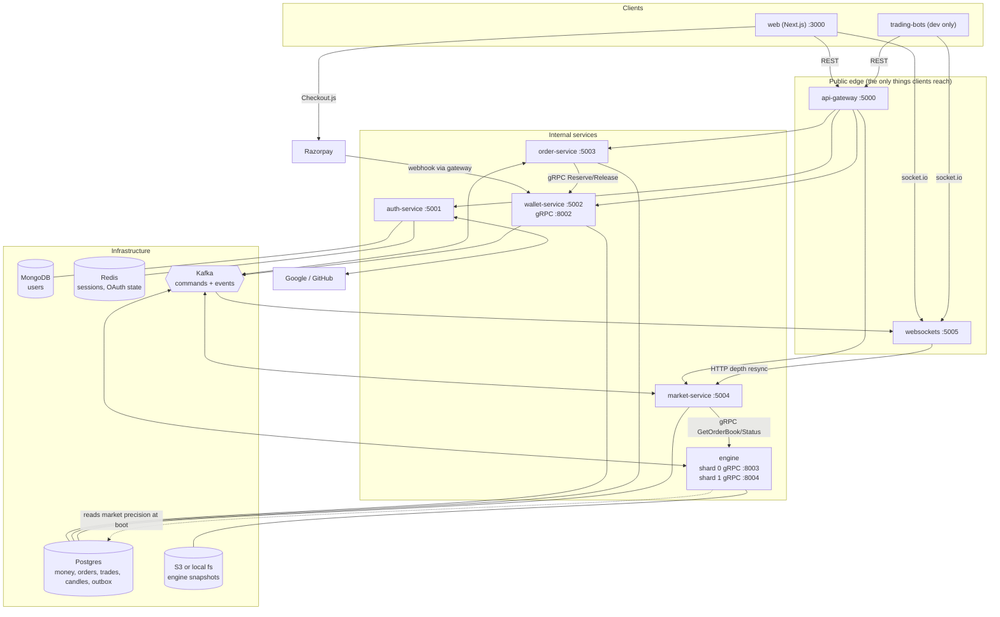

# 1. System overview

## What Aurax is

A centralised crypto **spot** exchange:

- Users sign in with **Google or GitHub** (OAuth).
- They deposit **INR through Razorpay**. The deposit is credited as **USDC**
  at a fixed rate (`USDC_INR_RATE`).
- They trade four markets: `BTCUSDC`, `ETHUSDC`, `SOLUSDC`, `USDTUSDC`.
- Orders are matched by an **in-memory price-time priority engine**.
- Order books, trades, tickers, candles and the user's own orders and balances
  stream to the browser in real time.

## Component map



## The rules the design follows

These rules explain most of the decisions in the code.

1. **Two public doors only.** Clients reach `api-gateway` and `websockets`.
   Everything else is internal. The one exception is the Razorpay webhook,
   which also enters through the gateway.

2. **Each service checks the JWT itself.** The gateway does not check tokens.
   It routes and rate-limits. Each service that needs a user verifies the
   access token locally with the shared `JWT_ACCESS_SECRET`. No service calls
   auth-service on every request.

3. **The engine only matches.** It never reads or writes balances and never
   writes to Postgres. It reads market precision from Postgres once at startup.
   Its book lives in memory, and durability comes from the Kafka command log
   plus periodic snapshots.

4. **Money moves only inside Postgres transactions.** Reserving funds,
   settling a fill, releasing a reservation and crediting a deposit each happen
   in one DB transaction. CHECK constraints keep balances non-negative.

5. **Commands go in through Kafka, results come out through Kafka.**
   order-service never calls the engine directly. It writes an `order.created`
   command to the `order.events` topic. The engine answers with execution
   reports on `trade.executed`.

6. **At-least-once delivery, idempotent consumers.** Kafka can deliver a
   message twice. Every event has a deterministic id (for example
   `trade:<takerOrderId>-f3`) and every consumer that changes state checks it.
   "Exactly once" comes from this, not from Kafka.

7. **No dual writes.** A service never commits to Postgres and then publishes
   to Kafka as two separate steps. It writes an `OutboxEvent` row in the same
   transaction, and a relay publishes it later (see
   [Reliability](07-reliability.md#transactional-outbox)).

8. **Partition key = what must stay in order.** Market events use the symbol
   as key, so one market's commands and fills stay in order. User events use
   the userId, so one user's balance updates stay in order.

## Tech stack

| Area | Choice |
|---|---|
| Runtime | Bun 1.3, TypeScript 5.9 |
| Monorepo | Turborepo, Bun workspaces (`apps/*`, `packages/*`, `scripts`) |
| HTTP | Express, `http-proxy-middleware` (gateway) |
| RPC | `@grpc/grpc-js` with `.proto` files in `packages/grpc/proto` |
| Messaging | Kafka (KRaft, single broker in dev) via `kafkajs` 2.2.4 (patched) |
| Relational DB | Postgres 17 via Prisma 7 (`@prisma/adapter-pg`) |
| Document DB | MongoDB 8 via Mongoose (users only) |
| Cache / sessions | Redis Stack |
| Real time | socket.io (server and client) |
| Validation | zod |
| Logging | pino (`packages/logger`) |
| Frontend | Next.js (App Router), Redux Toolkit, Tailwind, shadcn/ui |
| Payments | Razorpay Orders + Checkout.js + signed webhooks |
| Snapshots | AWS S3 (`@aws-sdk/client-s3`) or the local filesystem |

## Ports

| Process | Port | Protocol |
|---|---|---|
| web | 3000 | HTTP |
| api-gateway | 5000 | HTTP |
| auth-service | 5001 | HTTP |
| wallet-service | 5002 / 8002 | HTTP / gRPC |
| order-service | 5003 | HTTP |
| market-service | 5004 | HTTP |
| websockets | 5005 | HTTP + socket.io |
| engine shard 0 / 1 | 8003 / 8004 | gRPC |
| Redis / MongoDB / Postgres / Kafka | 6379 / 27017 / 5432 / 9092 | |

## Repository layout

```
apps/
  api-gateway/     reverse proxy, CORS, rate limits
  auth-service/    OAuth, JWT, refresh sessions
  wallet-service/  balances, reservations (gRPC), Razorpay deposits, history
  order-service/   order intake, cancel, history, trade settlement
  engine/          matching engine (supervisor + shards)
  market-service/  markets, tickers, depth, trades, candles
  websockets/      socket.io gateway (public + private streams)
  web/             Next.js frontend
  trading-bots/    dev-only bots that trade through the public API
packages/
  core/            REST helpers (ApiError, ApiReponse, asyncHandler), JWT, validation
  grpc/            proto files, generated types, client/server helpers
  kafka/           kafkajs client, shared producer, TOPICS
  postgres/        (@repo/pg) Prisma schema, migrations, seed, outbox, reconcile
  mongodb/         Mongoose connection + User model
  redis/           Redis client + typed helpers
  logger/          pino logger
  eslint-config/, typescript-config/
scripts/           Kafka topic creation
docs/              documentation (you are here)
```
