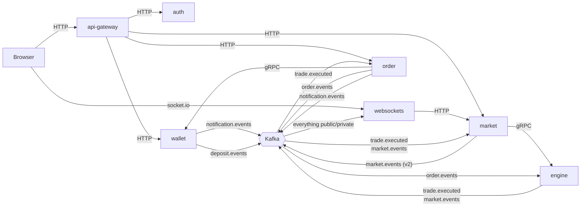
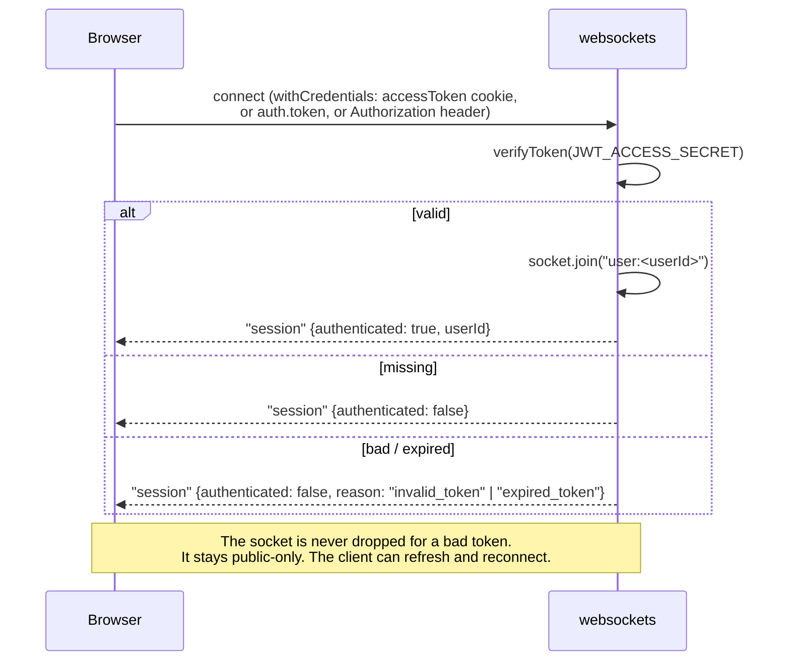

# 3. How services communicate

Aurax uses four transports. Each one has a clear job.

| Transport | Used when | Examples |
|---|---|---|
| **HTTP (REST)** | A client needs an answer now | Place order → `202`, list balances, OAuth redirect |
| **gRPC** | One internal service needs an answer now, fast and typed | Reserve funds before an order exists; fetch the live book |
| **Kafka** | Something happened, or something must be done, and the sender should not wait | Engine commands, fills, balance changes, market data |
| **socket.io** | Push live data to the browser | Depth, trades, ticker, candles, the user's own orders and balances |

## Who talks to whom



Full matrix:

| From → To | How | What |
|---|---|---|
| Browser → api-gateway | HTTP | All REST |
| Browser → websockets | socket.io | Subscriptions; receives live data |
| Razorpay → api-gateway → wallet | HTTP webhook | `payment.captured`, HMAC-signed |
| api-gateway → auth/wallet/order/market | HTTP proxy | Same request, mount path stripped |
| order-service → wallet-service | gRPC `:8002` | `ReserveBalance`, `ReleaseBalance` |
| market-service → engine | gRPC `:8003/:8004` | `GetEngineStatus`, `GetOrderBook` |
| websockets → market-service | HTTP (direct) | Depth snapshot for resync, list of symbols |
| order-service → engine | Kafka `order.events` | `order.created`, `order.cancel_requested` |
| engine → order/market/websockets | Kafka `trade.executed` | Execution reports |
| engine → market-service | Kafka `market.events` | `orderbook.updated` (full book) |
| market-service → websockets | Kafka `market.events` | `depth/trades/ticker/candles.updated` |
| wallet & order → websockets | Kafka `notification.events` | `balance.updated` |
| wallet → websockets | Kafka `deposit.events` | `deposit.completed` |

Nothing calls auth-service except the browser. Services trust the JWT
signature instead.

---

## HTTP

- Every response uses the same envelope from `@repo/core/rest`:
  `{ success, data, message, statusCode }`. Errors come from `ApiError` and
  can carry `errors: [{ field?, code?, message? }]`.
- Auth: services read `Authorization: Bearer <token>` first, then the
  `accessToken` cookie (`apps/*/src/middleware/auth.middleware.ts`).
- Bodies are limited to 16 KB on wallet, order and market.
- Full contract: [`../frontend-integration/http-api.md`](../frontend-integration/http-api.md)
  and [`openapi.yaml`](../frontend-integration/openapi.yaml).

---

## gRPC

Protos live in `packages/grpc/proto`. Generated types come from
`@repo/grpc`.

### `wallet.WalletService` (wallet-service, `:8002`)

```proto
rpc ReserveBalance(ReserveBalanceRequest) returns (ReserveBalanceResponse);
  // user_id, asset_symbol (= assetId), amount (decimal string), reference_id
  // → success, reservation_id, error_code
rpc ReleaseBalance(ReleaseBalanceRequest) returns (ReleaseBalanceResponse);
  // reference_id → success, error_code
```

Why gRPC and not Kafka here? The order must not exist unless the money is
locked, and the user needs a yes or no in the HTTP response. A synchronous
call is the simplest correct answer.

### `order.MatchingEngine` (engine shards, `:8003 + shard index`)

```proto
rpc GetEngineStatus(GetEngineStatusRequest) returns (GetEngineStatusResponse);
  // → is_ready, status ("LIVE" | "RECOVERY"), error_code ("ENGINE_NOT_READY")
rpc GetOrderBook(GetOrderBookRequest) returns (GetOrderBookResponse);
  // symbol → symbol, sequence_number, bids[], asks[] (price, quantity strings)
```

`GetOrderBook` returns `UNAVAILABLE` while the shard is in `RECOVERY`, and
`NOT_FOUND` for a symbol this shard does not own.

Routing: market-service reads
`ORDER_GRPC_URL=BTCUSDC,ETHUSDC=127.0.0.1:8003;SOLUSDC,USDTUSDC=127.0.0.1:8004`
and picks the shard for each symbol.

---

## Kafka

Client: `packages/kafka/src/client.ts`. Brokers come from `KAFKA_BROKERS`
(default `localhost:9092`). Topics are created by
`scripts/src/kafka/create-topics.ts`.

### Topics

| Topic | Kind | Key | Producer | Consumers |
|---|---|---|---|---|
| `order.events` | **Commands** | symbol | order-service (outbox) | engine shards, websockets |
| `trade.executed` | **Execution reports** | symbol | engine | order-service, market-service, websockets |
| `market.events` | Book + public market data | symbol | engine, market-service | market-service, websockets |
| `notification.events` | `balance.updated` | userId | wallet & order (outbox) | websockets |
| `deposit.events` | `deposit.completed` | userId | wallet (outbox) | websockets |
| `withdrawal.events` | (reserved, not used yet) | — | — | — |

### Why these keys

Kafka only keeps order **inside one partition**, and a key always goes to the
same partition.

- `order.events` keyed by symbol: the engine sees one market's commands in
  one fixed order. Replaying the log gives the same book and the same fills.
  This is what makes crash recovery possible.
- `trade.executed` keyed by symbol: a market's fills and its cancels arrive in
  engine order, so a cancel can never arrive before the fills that came
  before it. order-service relies on this.
- `notification.events` and `deposit.events` keyed by userId: one user's
  balance updates stay in order.

### Consumer groups

A Kafka consumer group gets each message **once per group**. Aurax uses this
on purpose:

| Group | Topic | Why this shape |
|---|---|---|
| `engine.BTCUSDC-ETHUSDC`, `engine.SOLUSDC-USDTUSDC` | `order.events` | One group per shard, so each shard sees **every** command and skips symbols it does not own |
| `order-service.execution-reports` | `trade.executed` | Shared by order-service replicas: each fill is settled by one replica |
| `market-service.trades` | `trade.executed` | Shared by market-service replicas |
| `market-service.orderbook` | `market.events` | Shared by market-service replicas |
| `websockets.market-data.<INSTANCE_ID>` | `market.events` | **Per instance:** every instance must see every event for its own sockets |
| `websockets.user-orders.<INSTANCE_ID>` | `order.events` | Per instance |
| `websockets.user-executions.<INSTANCE_ID>` | `trade.executed` | Per instance |
| `websockets.user-balances.<INSTANCE_ID>` | `notification.events` | Per instance |
| `websockets.user-deposits.<INSTANCE_ID>` | `deposit.events` | Per instance |

Prefixes can be changed with `KAFKA_GROUP_PREFIX` in each service.

### Producer settings

- Engine: `acks: -1` (all in-sync replicas), GZIP, headers `event-type` and
  `event-id` (`apps/engine/src/producers/order.ts`).
- Outbox relay: `acks: -1`, GZIP, header `event-id`.

### Message contracts

**Commands** (`order.events`), written by
`apps/order-service/src/repositories/order.repositorie.ts`:

```jsonc
// order.created
{ "eventId": "order.created:<orderId>", "event": "order.created",
  "orderId": "...", "userId": "...", "symbol": "BTCUSDC",
  "side": "BUY", "orderType": "LIMIT", "timeInForce": "GTC",
  "price": "65000.5", "quantity": "0.01", "postOnly": false,
  "status": "PENDING", "createdAt": "2026-11-16T10:00:00.000Z" }

// order.cancel_requested
{ "eventId": "order.cancel_requested:<orderId>", "event": "order.cancel_requested",
  "orderId": "...", "userId": "...", "symbol": "BTCUSDC", "requestedAt": "..." }
```

**Execution reports** (`trade.executed`), defined in
`apps/engine/src/types/events.ts`. All decimals are strings at market
precision.

| Event | `eventId` | Main fields |
|---|---|---|
| `order.opened` | `opened:<orderId>` | orderId, userId, side, price, executedQuantity, remainingQuantity |
| `trade.executed` | `trade:<takerOrderId>-f<n>` | tradeId, marketId, price, quantity, `maker{orderId,userId,status,side,executedQuantity,remainingQuantity}`, `taker{…}` |
| `order.cancelled` | `cancelled:<orderId>` | reason `USER_CANCELLED` / `IOC_REMAINING_QUANTITY` / `MARKET_NO_LIQUIDITY`, executedQuantity, remainingQuantity |
| `order.rejected` | `rejected:<orderId>` | reason (`INVALID_QUANTITY`, `POST_ONLY_MARKET_ORDER`, `POST_ONLY_WOULD_TAKE_LIQUIDITY`, `FOK_NOT_FULLY_FILLABLE`) |
| `order.cancel_rejected` | `cancel-rejected:<orderId>` | reason `NOT_OPEN` / `NOT_OWNER` |

**Engine book** (`market.events`):

```jsonc
{ "event": "orderbook.updated", "symbol": "BTCUSDC", "sequenceNumber": "1042",
  "bids": [{ "price": "65000", "quantity": "0.5" }], "asks": [...], "timestamp": 1700000000000 }
```

This is the **full** book every time, not a diff.

**Market data v2** (`market.events`, from market-service): each message has
`eventId`, `schemaVersion: 2`, `symbol`, `timestamp`, `type` and `data`.

| `type` | `sequenceNumber` | `data` |
|---|---|---|
| `depth.updated` | per-symbol, increasing | `kind: "snapshot"` (full top-N) or `kind: "delta"` with `prevSequenceNumber` |
| `trades.updated` | `null` | tradeId, price, quantity, quoteQuantity, side (taker side), isBuyerMaker, executedAt |
| `ticker.updated` | increasing | lastPrice, 24h open/high/low/change/volumes, tradeCount24h |
| `candles.updated` | increasing | interval, openTime, closeTime, open/high/low/close, baseVolume, quoteVolume, tradeCount, isClosed |

Full spec: [`MARKET_DATA_PROTOCOL.md`](../../apps/market-service/MARKET_DATA_PROTOCOL.md).

**Balance** (`notification.events`), built by
`packages/postgres/src/balance-events.ts`:

```jsonc
{ "eventId": "balance:<reason>:<referenceId>:<userId>:<assetId>",
  "event": "balance.updated", "userId": "...", "assetId": "...", "asset": "USDC",
  "available": "100.5", "locked": "20", "total": "120.5",
  "reason": "DEPOSIT | ORDER_RESERVED | ORDER_RELEASED | TRADE | ...",
  "referenceId": "...", "version": 1700000000000, "timestamp": 1700000000000 }
```

It is the wallet row **after** the change. `version` is the wallet's
`updatedAt` in ms. A client keeps only the highest version.

---

## socket.io to the browser

Server: `apps/websockets`. Client: `apps/web/lib/ws`.

### Connecting and auth



### Public market data (socket event `market`)

Client sends:

```jsonc
{ "action": "subscribe", "channel": "depth", "symbol": "BTCUSDC" }
{ "action": "subscribe", "channel": "candles", "symbol": "BTCUSDC", "interval": "1m" }
{ "action": "subscribe", "subscriptions": [{ "channel": "trades", "symbol": "ETHUSDC" }] }
{ "action": "unsubscribe", "channel": "ticker", "symbol": "BTCUSDC" }
{ "action": "resync", "channel": "depth", "symbol": "BTCUSDC" }
```

Server replies with `{ type: "snapshot" | "update" | "resync" | "error", ... }`.

Rooms: `md:depth:SYM`, `md:trades:SYM`, `md:ticker:SYM`,
`md:candles:SYM:INTERVAL`. A new subscriber gets an immediate snapshot from
the hub's in-memory cache. No database call is made per update.

**Depth sequencing** (`market/depth-mirror.ts`): a delta is applied only if
its `prevSequenceNumber` equals the current sequence. A delta at or below the
current sequence is a duplicate and is ignored. Anything else is a gap: deltas
are buffered and the mirror asks market-service for a REST snapshot (backoff
1s → 30s), or waits for the next periodic Kafka snapshot. Clients get a
`resync` message and should reset their book.

### Private events (socket event `user`)

There is no subscribe step. The room comes from the token.

| Kafka source | Socket `type` |
|---|---|
| `order.events` `order.created` | `order.accepted` |
| `trade.executed` `order.opened` | `order.opened` |
| `trade.executed` `trade.executed` (sent to maker and taker separately) | `trade.executed` + `order.partially_filled` or `order.filled` |
| `trade.executed` `order.cancelled` / `order.rejected` / `order.cancel_rejected` | same name |
| `notification.events` `balance.updated` | `balance.updated` |
| `deposit.events` `deposit.completed` | `deposit.completed` |

Message shape: `{ type, eventId, data, timestamp }`. Counterparty ids,
reservation ids and fees are never sent. Delivery is at-least-once, so
clients dedupe by `eventId`.
