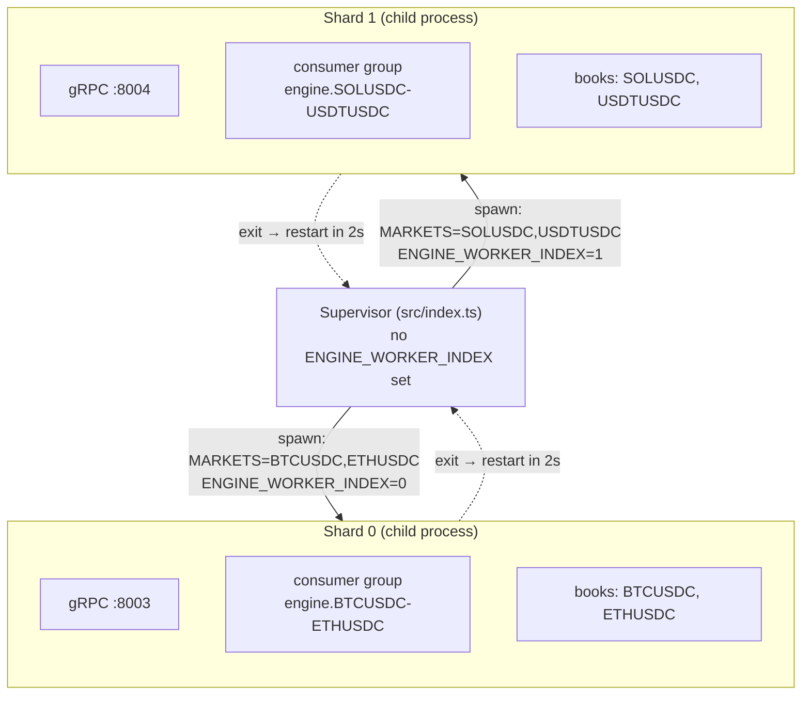
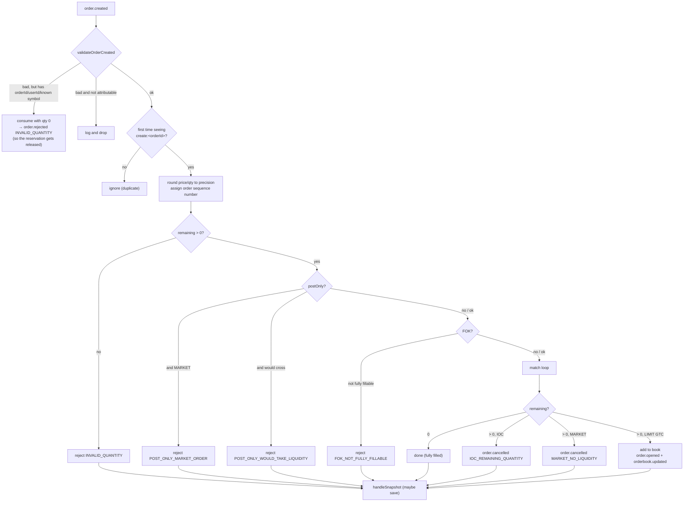
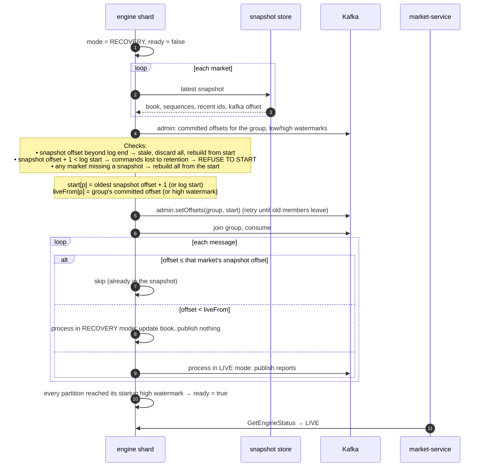

# 4. The matching engine

Code: `apps/engine/src`. This is the heart of the exchange. It takes order
commands in a fixed order and turns them into trades and book updates.

## What it is responsible for

- Keeping the live order book for each market, in memory.
- Matching incoming orders against resting orders with **price-time
  priority**.
- Publishing an execution report for every outcome (opened, filled,
  cancelled, rejected).
- Publishing the full book after every change.
- Saving snapshots and recovering after a crash **without losing or
  duplicating** anything.

What it does **not** do: check balances, reserve funds, write to Postgres, or
serve HTTP. order-service has already checked the order and locked the money
before the engine sees it. The engine trusts that.

## Process model and sharding



- The same file is both the supervisor and the shard. If
  `ENGINE_WORKER_INDEX` is not set, it is the supervisor. It reads
  `MARKETS_A` and `MARKETS_B` and spawns one child process for each non-empty
  list.
- A shard that exits is restarted after 2 seconds. On `SIGINT`/`SIGTERM` the
  supervisor forwards the signal and exits after the children stop (5s
  limit).
- Child processes are used instead of `node:cluster`, because each shard needs
  its own gRPC port, and `cluster` shares listening sockets through the
  primary, which fails under Bun.
- Each shard (`src/main.ts`):
  1. `engine.load()`: reads its markets from Postgres (only for
     `pricePrecision` and `quantityPrecision`). Startup fails if a market is
     missing.
  2. Connects the Kafka producer.
  3. Starts gRPC on `ENGINE_GRPC_HOST:(ENGINE_GRPC_BASE_PORT + index)`.
     This happens **before** recovery, so `GetEngineStatus` can report
     `RECOVERY`.
  4. Runs `consumeOrder(markets)`: recovery, then live consumption.

### Why one thread per shard matters

Each shard processes Kafka messages **one at a time**. Matching never runs in
parallel within a shard. With one fixed input order (Kafka, keyed by
symbol), this makes the engine **deterministic**: the same command log always
produces the same book, the same fills and the same fill ids. Crash recovery
depends on this.

## The order book

`src/orderbook/orderbook.ts`:

```
OrderBook(market)
  bids:  Map<price, Order[]>     each array is FIFO = time priority
  asks:  Map<price, Order[]>
  index: Map<orderId, Order>     O(1) lookup for cancel
```

| Operation | How |
|---|---|
| Add | push to the end of the price level array (create level if new) |
| Remove | find in the level array, splice, delete empty level |
| Best bid / ask | scan the price keys for max / min (O(number of levels)) |
| Levels for publishing | sort prices, sum `remainingQuantity` per level |

Quantities are rounded to the market's `quantityPrecision` after every
change (`roundQty`), so floating-point residue like `0.3 - 0.1 =
0.19999999999999998` never builds up.

### The engine's `Order`

```ts
{ id, userId, symbol, side: BUY|SELL, type: LIMIT|MARKET, timeInForce: GTC|IOC|FOK,
  price, quantity, filledQuantity, remainingQuantity, executedQuantity,
  postOnly, timestamp, sequenceNumber, fills: Fill[] }
```

The engine uses JavaScript numbers rounded to market precision. Postgres and
order-service use exact decimals. That is safe because the engine only reports
quantities and prices, and settlement recomputes all money with `Decimal`
from persisted state.

## Processing an `order.created`

Entry: `handlers/order.handlers.ts` → `MatchingEngine.consumeOrder`.



### The match loop (price-time priority)

```text
while taker.remaining > 0:
    maker = taker is BUY ? book.bestAsk() : book.bestBid()   # first order at best price
    if maker is none: stop
    if taker is LIMIT and price does not cross: stop
        # BUY crosses if taker.price >= maker.price
        # SELL crosses if taker.price <= maker.price
    qty = min(taker.remaining, maker.remaining)
    executeTrade(taker, maker, qty, price = maker.price)
```

`executeTrade`:

1. `tradeId = "<takerOrderId>-f<n>"`, where `n` is the taker's fill count + 1.
   This is **deterministic**: replaying the same commands gives the same ids.
2. Decrease `remainingQuantity` and increase `filled/executedQuantity` on both
   orders (rounded), and push the fill to both.
3. Remove the maker from the book if it is filled, otherwise update it in
   place (it keeps its place in the queue).
4. Publish `trade.executed` with both parties' status (`PARTIALLY_FILLED` or
   `FILLED`) and their executed/remaining quantity.
5. Publish `orderbook.updated` (the full book, next book sequence number).

Rules that follow from this:

- **Trades happen at the maker's price.** A buy at 101 that hits an ask at 100
  fills at 100.
- **Better price first, then older order first.** Best price comes from the
  map keys. Inside a price level the array is FIFO.
- **A partial maker fill keeps its queue position.**

### Order types and options

| Option | Behaviour in the engine |
|---|---|
| `LIMIT` + `GTC` | Match what crosses, rest the remainder → `order.opened` |
| `LIMIT` + `IOC` | Match what crosses, cancel the remainder → `order.cancelled IOC_REMAINING_QUANTITY` |
| `LIMIT` + `FOK` | Pre-check that the book can fill all of it at acceptable prices (`canFullyFill`). If not → `order.rejected FOK_NOT_FULLY_FILLABLE`, book untouched |
| `MARKET` | Crosses at any price, never rests. Remainder → `order.cancelled MARKET_NO_LIQUIDITY` |
| `postOnly` | BUY must be below best ask, SELL above best bid, or it is rejected. Never takes liquidity |

Checks done earlier in order-service (so the engine rarely sees them):
`MARKET` buys are rejected (the engine cannot cap how much quote a market buy
spends, so no reservation could cover it). `MARKET` + `GTC` becomes `IOC`.
`postOnly` must be `LIMIT` + `GTC`.

### Processing an `order.cancel_requested`

1. Dedupe on `cancel:<orderId>`.
2. Look the order up in the index.
3. Not found → `order.cancel_rejected NOT_OPEN` (already filled, already
   cancelled, or never rested).
4. Different user → `order.cancel_rejected NOT_OWNER`.
5. Otherwise remove it, publish `order.cancelled USER_CANCELLED` with the
   executed and remaining quantity, then publish the new book.

### Example

Book before (BTCUSDC):

```
asks: 100.0 × 1.0 (A, older)   100.0 × 0.5 (B)   101.0 × 2.0 (C)
bids:  99.0 × 1.0
```

Incoming `LIMIT BUY 2.0 @ 100.5 GTC` (order T):

| Step | Maker | Qty | Price | Event |
|---|---|---|---|---|
| 1 | A | 1.0 | 100.0 | `trade.executed` tradeId `T-f1`, A FILLED, T PARTIALLY_FILLED |
| 2 | B | 0.5 | 100.0 | `trade.executed` tradeId `T-f2`, B FILLED |
| 3 | C @ 101.0 does not cross 100.5 → stop | | | |
| 4 | T rests 0.5 @ 100.5 | | | `order.opened` (executed 1.5, remaining 0.5) |

Each step also publishes an `orderbook.updated`. Book after:

```
asks: 101.0 × 2.0
bids: 100.5 × 0.5 (T)   99.0 × 1.0
```

## Duplicate command protection

Kafka can deliver a command twice, and the outbox relay can publish it twice.
Each market keeps a **bounded set of recent command ids** (`RecentIds`, the
latest 50,000, insertion ordered). Keys are `create:<orderId>` and
`cancel:<orderId>`. A command already in the set is ignored. The set is saved
in snapshots, so dedupe still works after a restart.

## Sequence numbers

Each market has two counters:

- **Order sequence**: incremented for every accepted `order.created`. Stored
  on the order.
- **Book sequence**: incremented for every `orderbook.updated` published.
  market-service uses it to detect gaps, regressions and stale books.
  `GetOrderBook` returns the current value, so a gRPC snapshot and a Kafka
  update can be compared.

Both counters are saved in snapshots.

## Snapshots

`handleSnapshot` runs after every processed command, in LIVE mode only:

- Every `SNAPSHOT_EVERY` commands per market (default 100), the shard saves a
  snapshot (`getSnapshot`):

  ```jsonc
  { "version": 2, "symbol": "BTCUSDC",
    "sequenceNumber": 1042,          // book sequence
    "orderSequenceNumber": 377,
    "recentCommandIds": ["create:...", "cancel:..."],
    "kafka": { "topic": "order.events", "partition": 0, "offset": "5120" },  // last command included
    "orders": [ /* every resting order, with fills */ ] }
  ```

- Store (`src/utils/s3.ts`): S3 at `snapshots/<SYMBOL>/<ISO timestamp>.json`,
  or the local directory `SNAPSHOT_DIR` (default `.snapshots`) when
  `SNAPSHOT_STORE=fs`. The default is `s3` if `S3_BUCKET_NAME` is set,
  otherwise `fs`. The latest snapshot is the one with the highest name
  (timestamps sort correctly as strings).

## Crash recovery

The book lives only in memory. After a crash it is rebuilt from **the latest
snapshot plus the Kafka command log after it**. The hard part is publishing
correctly: reports that were already published before the crash must not be
published again as new facts, and reports that might not have been published
must be published.

Code: `src/consumers/order.consumer.ts` → `consumeOrder`.



Why this is correct:

- **Before the committed offset:** Kafka only commits an offset after the
  message was fully processed, and that includes publishing its reports. So
  these reports are already out. Replaying silently rebuilds the state without
  repeating them.
- **At or after the committed offset:** the engine may have crashed after
  publishing but before committing. So these are replayed **live**. If a
  report goes out twice, it has the **same deterministic id**
  (`trade:<taker>-f<n>`, `opened:<id>`, ...), and every consumer drops the
  duplicate.
- **Determinism** makes this work. The same commands in the same order give
  the same fills with the same ids.

Edge cases the code handles:

| Case | What happens |
|---|---|
| No snapshot for some market | All books are rebuilt from the start of the log |
| Snapshot offset is past the end of the log (Kafka was wiped) | Snapshots are discarded; everything is replayed **live** (committed offsets from the old log mean nothing) |
| Committed offset is past the end of the log | Treated as 0, so everything is replayed live |
| Retention deleted commands between the snapshot and the log start | **The shard refuses to start**, rather than run with a wrong book |
| A previous instance of the group is still registered | `setOffsets` retries every 2s, up to 30 times |
| Processing throws | The offset is not resolved; kafkajs retries from that message |
| Non-JSON or empty message | Skipped and resolved |
| Message for a symbol of another shard | Skipped and resolved |

Readiness: `ready` becomes `true` once every partition reaches the high
watermark seen at startup. Until then `GetEngineStatus` returns
`RECOVERY` / `ENGINE_NOT_READY`, and `GetOrderBook` returns `UNAVAILABLE`.
market-service waits for `LIVE` before it serves data.

## Configuration

| Variable | Default | Meaning |
|---|---|---|
| `MARKETS_A`, `MARKETS_B` | — | Comma-separated markets for shard 0 and shard 1 |
| `ENGINE_GRPC_HOST` | `0.0.0.0` | gRPC bind host |
| `ENGINE_GRPC_BASE_PORT` | `8003` | Shard `i` listens on base + `i` |
| `KAFKA_GROUP_PREFIX` | `engine` | Group = `<prefix>.<sorted markets joined by ->` |
| `SNAPSHOT_STORE` | `s3` if bucket set, else `fs` | Where snapshots go |
| `SNAPSHOT_DIR` | `.snapshots` | Directory for `fs` |
| `SNAPSHOT_EVERY` | `100` | Commands per market between snapshots |
| `S3_REGION`, `S3_ACCESS_KEY_ID`, `S3_SECRET_ACCESS_KEY`, `S3_BUCKET_NAME` | — | S3 settings |
| `PG_DATABASE_URL` | — | Read once at boot for market precision |

## Tests

`apps/engine/test/matching.test.ts` covers price-time priority, partial fills,
IOC, FOK, post-only and cancel. It uses `engine.configureMarkets(...)` so no
database is needed. Run with `cd apps/engine && bun test`.

## Limits worth knowing

- Best bid/ask is a linear scan over price levels. That is fine for a few
  hundred levels. A sorted structure (a heap or tree) would be needed for deep
  books.
- Two shards are hard-wired (`MARKETS_A`, `MARKETS_B`). Adding a third means a
  code change in `index.ts` and `config/env.ts`.
- Every shard reads all of `order.events` and drops other symbols. With
  several partitions this is still correct (keyed by symbol), but each shard
  reads everyone's traffic.
- Replay length after a crash is at most about `SNAPSHOT_EVERY` commands per
  market, plus whatever arrived while the shard was down.
