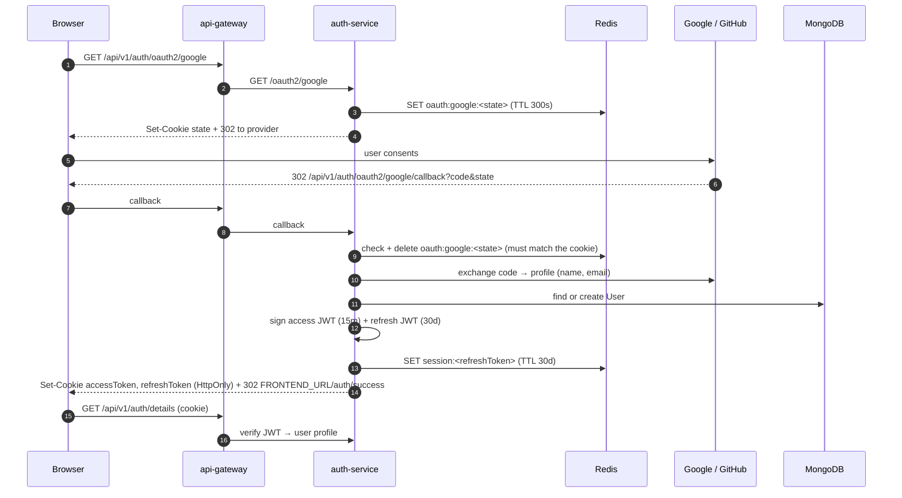
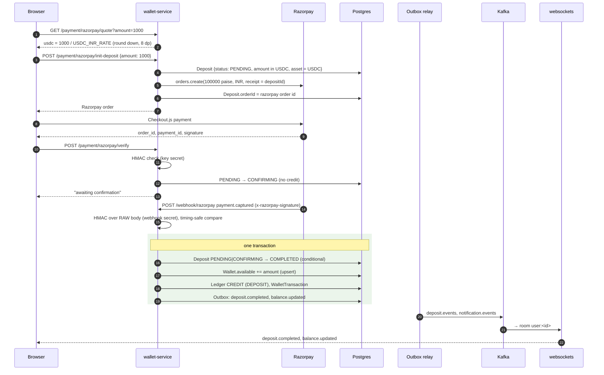
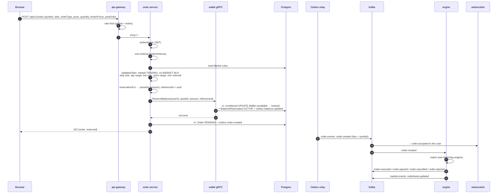
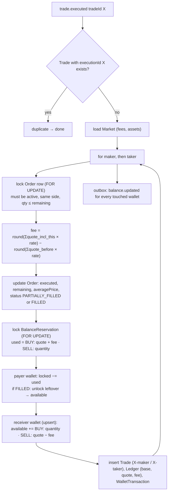
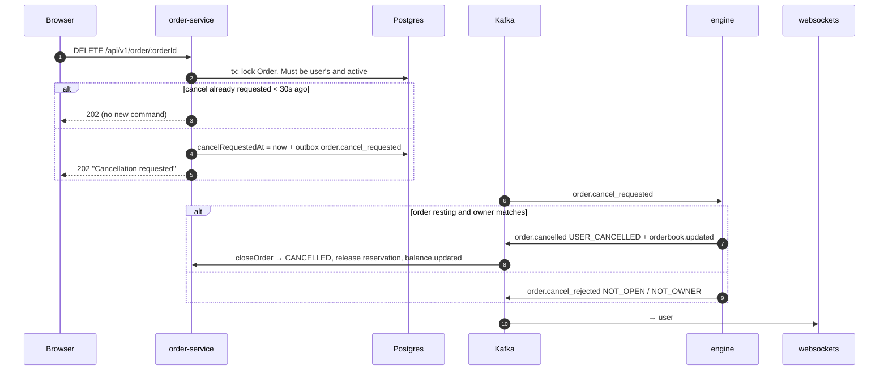
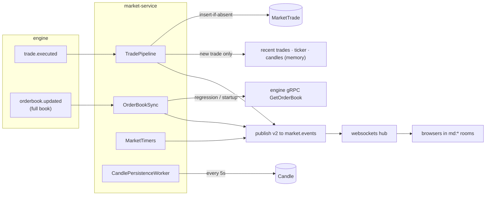
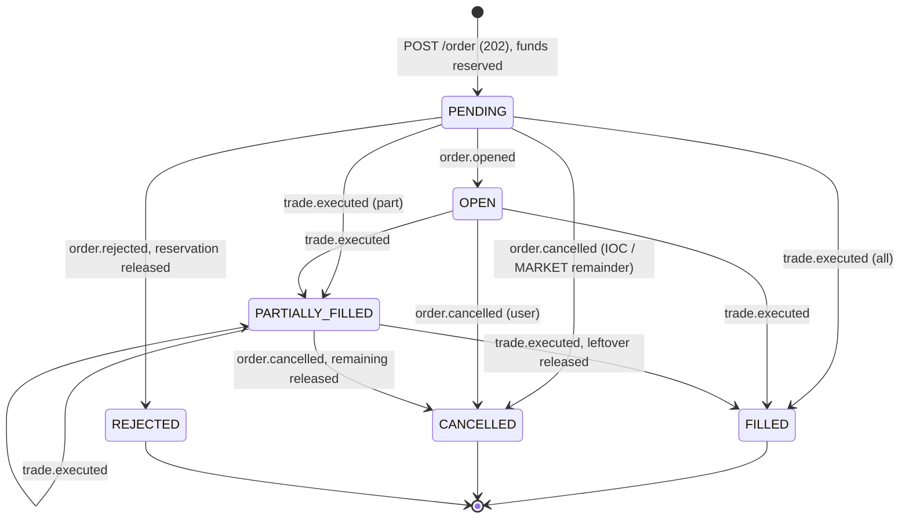

# 5. End-to-end flows

Each flow shows every hop, what is written where, and what the user sees.

1. [Sign in with OAuth](#1-sign-in-with-oauth)
2. [Refresh and logout](#2-refresh-and-logout)
3. [Deposit INR → USDC](#3-deposit-inr--usdc)
4. [Place an order](#4-place-an-order)
5. [Settle a fill](#5-settle-a-fill)
6. [Order opened, cancelled or rejected](#6-order-opened-cancelled-or-rejected)
7. [Cancel an order](#7-cancel-an-order)
8. [Public market data](#8-public-market-data)
9. [Open the trading page](#9-open-the-trading-page)
10. [Engine restart](#10-engine-restart)
11. [Whole lifecycle of one order](#11-whole-lifecycle-of-one-order)

---

## 1. Sign in with OAuth

After this, every service verifies `accessToken` on its own. Nothing calls
auth-service per request.

## 2. Refresh and logout

- **Refresh:** `POST /api/v1/auth/sessions/refresh` with the refresh cookie.
  auth-service verifies the JWT, checks `session:<refreshToken>` exists in
  Redis, deletes it, creates a new pair and a new session. A refresh token
  works **once**. The web client makes sure only one refresh runs at a time,
  because two parallel refreshes would cancel each other.
- **Logout:** `POST /api/v1/auth/sessions/logout` deletes the Redis session
  and clears both cookies. The access token is still valid until it expires
  (at most 15 minutes), because services do not check Redis.
- **Socket:** after a refresh the web app reconnects the socket so it is
  authenticated with the new cookie.

## 3. Deposit INR → USDC

Key points:

- **Only the signed webhook credits money.** The client `verify` call can only
  move `PENDING` to `CONFIRMING`. It can never credit or move a deposit back.
- The webhook route is mounted **before** the JSON parser and auth, because
  the HMAC has to be computed over the exact raw bytes.
- The `COMPLETED` update is conditional (`WHERE status IN (PENDING,
  CONFIRMING)`), so a webhook delivered twice credits once.

## 4. Place an order

What gets reserved (`services/order-rules.ts`):

| Order | Asset locked | Amount |
|---|---|---|
| SELL (LIMIT or MARKET) | base (e.g. BTC) | `quantity` |
| LIMIT BUY | quote (USDC) | `price × quantity × (1 + max(makerFee, takerFee))`, rounded **up** to 8 dp |
| MARKET BUY | — | rejected with `400 MARKET_BUY_UNSUPPORTED` |

Errors the user can see:

| Situation | HTTP |
|---|---|
| Bad body / rule broken (`STEP_SIZE`, `TICK_SIZE`, `QUANTITY_RANGE`, `PRICE_RANGE`, `MIN_NOTIONAL`) | 400 |
| Market not found | 404 |
| `INSUFFICIENT_BALANCE`, `WALLET_NOT_FOUND` | 400 |
| `DUPLICATE_REFERENCE` | 409 |
| wallet gRPC down | 503 |
| Order insert failed after reserving | 500, and the reservation is released with `ReleaseBalance` |

`202 Accepted` only means "money locked and command queued". The real result
arrives on the socket, or from `GET /api/v1/order/:orderId`.

## 5. Settle a fill

order-service consumes `trade.executed` (group
`order-service.execution-reports`) and calls `executeTrade`
(`repositories/order.repositorie.ts`). All of this is **one Postgres
transaction**:

Worked example. Market BTCUSDC, maker fee 0.1%, taker fee 0.2%.
Alice has a resting `SELL 1 BTC @ 100` (maker). Bob sends
`LIMIT BUY 1 BTC @ 101` (taker), fills at 100.

| | Alice (maker, SELL) | Bob (taker, BUY) |
|---|---|---|
| Reserved at placement | 1 BTC | 101 × 1 × 1.002 = 101.202 USDC |
| quote | 100 USDC | 100 USDC |
| fee (quote asset) | 0.1 USDC | 0.2 USDC |
| Paid from reservation | 1 BTC | 100.2 USDC |
| Leftover released (order FILLED) | 0 | 1.002 USDC → available |
| Receives | 99.9 USDC | 1 BTC |

Why fees are computed as a difference of cumulative rounded values: rounding
each fill separately drifts upward over many small fills and could exceed a
BUY reservation. Computing `round(total) − round(previous total)` keeps the
sum of fees equal to the rounded fee of the total, which the reservation
(rounded up) always covers. A shortfall of up to 1e-8 per fill is still
tolerated and logged for orders settled before this fix.

If any check fails (order not found, wrong state, not enough reserved), the
transaction rolls back and throws `InvariantError`. The Kafka message is not
committed, so it is retried.

## 6. Order opened, cancelled or rejected

| Report | order-service action |
|---|---|
| `order.opened` | `UPDATE Order SET status=OPEN WHERE status=PENDING`. An order that is already `PARTIALLY_FILLED` stays that way |
| `order.cancelled` | In one tx: lock order. If it is already terminal, do nothing. If `executedQuantity` in the event ≠ settled executed quantity, **throw and retry** (a fill is not settled yet). Otherwise set `CANCELLED`, release the remaining reservation (`RELEASED`), and write `balance.updated` |
| `order.rejected` | Same, but status `REJECTED` and reservation status `CANCELLED` |
| `order.cancel_rejected` | Ignored by order-service. websockets forwards it to the user |

The executed-quantity check matters. On the `trade.executed` partition, fills
always come before the cancel. If the numbers do not match yet, releasing now
would give back money that a fill still needs.

## 7. Cancel an order

- The order stays active until `order.cancelled` is settled. Fills that
  happen before the cancel reaches the engine are still applied.
- A repeat after 30 seconds sends the command again, in case the first was
  lost. The engine dedupes it.
- Not your order → `404`. Already finished → `409`.

## 8. Public market data

1. **Trades:** `MarketTrade` insert-if-absent is the dedupe point. Only a
   newly inserted trade updates recent trades, the 24h ticker and the candles
   (1m, 5m, 15m, 1h, 1d). Then `trades.updated`, `ticker.updated` and
   `candles.updated` are published. The public `side` is the **taker's**
   side.
2. **Depth:** each `orderbook.updated` is checked by sequence. Newer replaces
   the mirror. Older at the same or older offset is stale and ignored. Older
   at a **newer** offset means the engine restarted, so the book is reloaded
   with gRPC. The diff from the last published top-N becomes a `delta`; the
   first publish and resyncs are `snapshot`s. Top `DEPTH_PUBLISH_LEVELS` (50)
   only.
3. **Timers:** full depth snapshot every 30s (lets lagging clients recover),
   ticker expiry every 5s, candle close every 1s, registry refresh every 60s.
4. **websockets** validates each event with zod, updates its own caches and
   depth mirror, and emits to rooms.

## 9. Open the trading page

1. Next.js loads `/trade/BTCUSDC`.
2. REST via the gateway: markets, ticker, order book, recent trades and
   candles from market-service. If signed in: balances
   (`/wallet/assets`) and open orders (`/order?status=open`).
3. The socket connects with the cookie and receives `session`.
4. The page subscribes to `depth`, `trades`, `ticker` and `candles:<interval>`
   for the symbol. Each subscription returns a snapshot first, then updates.
5. Private events arrive on `user` and update Redux (orders, balances,
   notifications).
6. On every reconnect (`epoch` changes) the app re-fetches REST state, because
   events may have been missed while it was offline.

## 10. Engine restart

1. Shard crashes. The supervisor restarts it after 2s.
2. The new shard loads snapshots, works out offsets, and replays (see
   [Matching engine → Crash recovery](04-matching-engine.md#crash-recovery)).
   `GetEngineStatus` returns `RECOVERY`.
3. Meanwhile order-service keeps accepting orders. Commands queue up in Kafka.
4. Replay after the committed offset publishes reports again. Duplicates are
   dropped by order-service (`executionId`), market-service (`MarketTrade`
   PK) and clients (`eventId`).
5. The shard reaches the high watermark, becomes `LIVE`, and processes the
   queued commands.
6. market-service sees a book sequence that went backwards at a newer offset,
   reloads from gRPC, and publishes a depth snapshot. websockets clients get a
   `resync`.

## 11. Whole lifecycle of one order

`EXPIRED` exists in the enum but nothing sets it yet.
