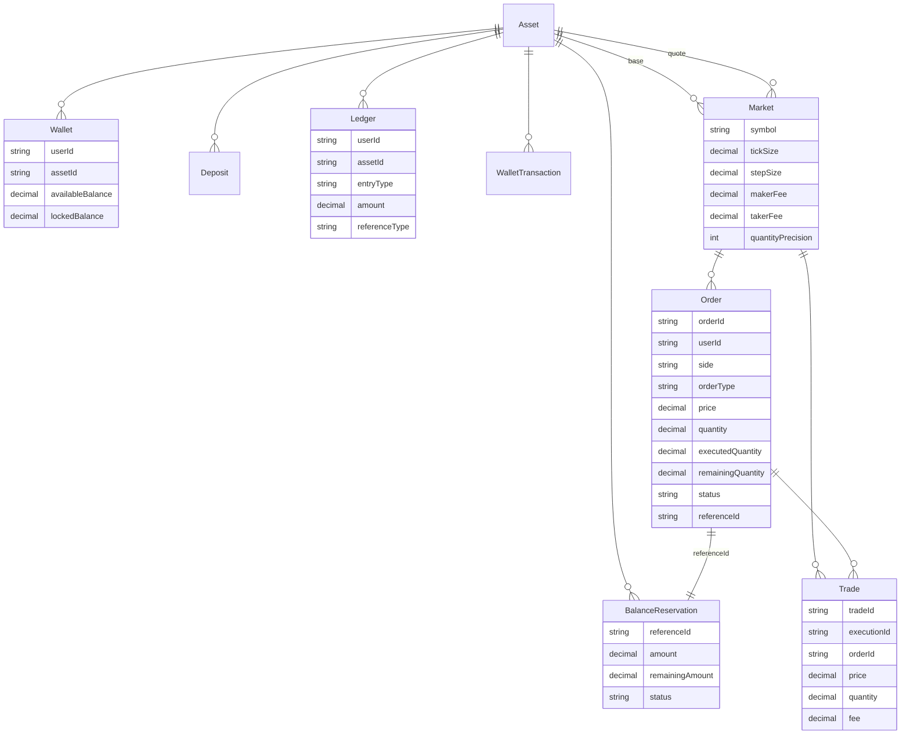
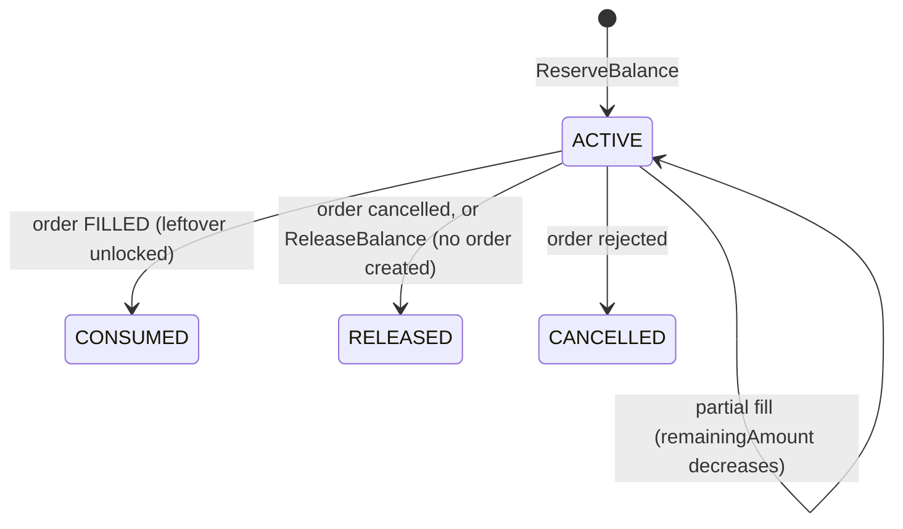
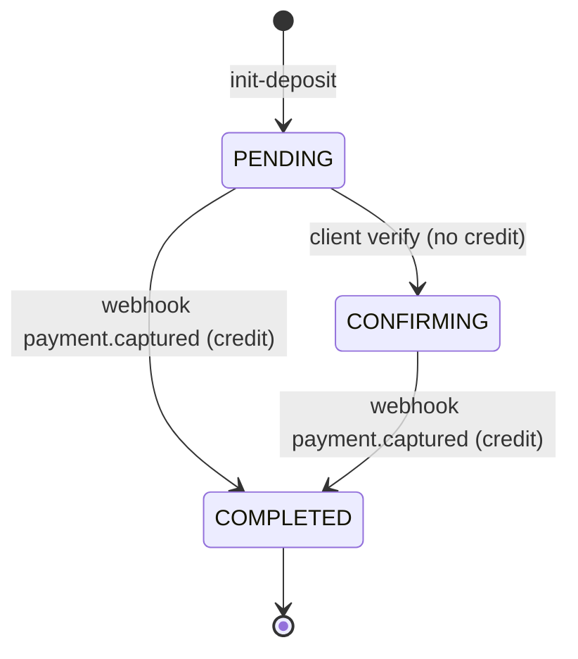

# 6. Data model

## Where each kind of data lives

| Data | Store | Owner (writes) | Readers |
|---|---|---|---|
| Users | MongoDB `User` | auth-service | auth-service |
| Refresh sessions | Redis `session:<refreshToken>` (30d) | auth-service | auth-service |
| OAuth state | Redis `oauth:<provider>:<state>` (5m) | auth-service | auth-service |
| Assets, markets | Postgres `Asset`, `Market` (seeded) | seed script | everyone |
| Balances | Postgres `Wallet` | wallet-service (reserve, deposit), order-service (settle, release) | wallet-service |
| Reservations | Postgres `BalanceReservation` | wallet-service (create), order-service (consume/release) | both |
| Orders, fills | Postgres `Order`, `Trade` | order-service | order-service |
| Ledger, transactions | Postgres `Ledger`, `WalletTransaction` | wallet-service, order-service | wallet-service |
| Deposits | Postgres `Deposit` | wallet-service | wallet-service |
| Live order book | engine memory + snapshots (S3/fs) | engine | engine gRPC, market-service mirror |
| Public trade tape | Postgres `MarketTrade` | market-service | market-service |
| Candles | Postgres `Candle` + memory | market-service | market-service |
| Tickers | market-service memory (rebuilt from `MarketTrade`) | market-service | market-service |
| Pending events | Postgres `OutboxEvent` | wallet-service, order-service | outbox relay |

All services that use Postgres share **one database** and one Prisma schema
(`packages/postgres/prisma/schema.prisma`). Ownership is a code convention,
not separate databases.

## Sources of truth

| Question | Authoritative answer | Fast or live copy |
|---|---|---|
| What does a user own? | `Ledger` (sum of credits − debits) | `Wallet` row; `balance.updated` events |
| What is locked? | `BalanceReservation` rows with `ACTIVE` status | `Wallet.lockedBalance` |
| What is the state of an order? | `Order` row | private socket events |
| What is on the book? | engine memory | market-service mirror → `depth` channel |
| What trades happened in public? | `MarketTrade` | market-service memory, `trades` channel |

`reconcileWallets()` checks that the fast copies agree with the authoritative
ones (see [Reliability](07-reliability.md#reconciliation)).

## Postgres tables

`userId` is a MongoDB user id stored as a string. There is no foreign key to
users, because users live in Mongo.

| Model | Key fields | Notes |
|---|---|---|
| `Asset` | `assetId` (cuid), `symbol` (unique), `decimals`, deposit/withdrawal flags, min amounts | Seeded: BTC, ETH, SOL, USDT, USDC. Code looks assets up by symbol when it needs one (e.g. deposits resolve `USDC`) |
| `Market` | `symbol`, `baseAssetId`, `quoteAssetId`, `status` (`TRADING`…), `tickSize`, `stepSize`, `min/maxPrice`, `min/maxQuantity`, `minNotional`, `makerFee`, `takerFee`, `pricePrecision`, `quantityPrecision`, `isEnabled` | Rules used by order-service; precision used by the engine |
| `Wallet` | unique (`userId`, `assetId`), `availableBalance`, `lockedBalance` (`Decimal(30,8)`) | CHECK constraints keep both ≥ 0 |
| `BalanceReservation` | `referenceId` (unique), `amount`, `remainingAmount`, `status` | One per order |
| `Order` | `orderId`, `referenceId` (unique), quantities `Decimal(30,18)`, `averagePrice`, `status`, `cancelRequestedAt` | |
| `Trade` | `tradeId` = `<executionId>-maker` or `-taker`, `executionId` = engine tradeId, `fee`, `feeAsset` | Two rows per execution, one per side |
| `Ledger` | `entryType` CREDIT/DEBIT, `referenceType` (DEPOSIT, TRADE, FEE, …), `referenceId` | Append-only |
| `WalletTransaction` | `type` (DEPOSIT, TRADE, …), `status`, `amount`, `referenceId` | User-facing history |
| `Deposit` | `orderId` (Razorpay, unique), `paymentId` (unique), `amount` (USDC), `status` | |
| `MarketTrade` | `tradeId` (PK = engine tradeId), `price`, `quantity`, `quoteAmount`, `side` (taker), `executedAt` | PK is the dedupe point |
| `Candle` | `symbol`, `interval`, `openTime`, OHLC, volumes, `tradeCount` | Upserted every 5s |
| `OutboxEvent` | `topic`, `key`, `payload` (JSON), `createdAt`, `publishedAt`, `attempts` | Shared by all relays |

Migrations: `packages/postgres/prisma/migrations`. Seed:
`packages/postgres/prisma/seed.ts`.

## State machines

### Order

See the diagram in [Flows](05-flows.md#11-whole-lifecycle-of-one-order).
Active = `PENDING`, `OPEN`, `PARTIALLY_FILLED`.
Terminal = `FILLED`, `CANCELLED`, `REJECTED`, `EXPIRED`.

### Reservation

### Deposit

`FAILED` exists in the enum. No code path sets it yet.

## Money math

- Balances, reservations and ledger amounts: `Decimal(30, 8)`. Order
  quantities and prices: `Decimal(30, 18)`.
- All money math uses `Prisma.Decimal` (`apps/order-service/src/lib/money.ts`),
  never JS numbers.
- `toWallet`: round **half-up** to 8 dp (the same rule Postgres uses on
  write), so what is computed equals what is stored.
- `toWalletUp`: round **up**. Used for reservations so they are never short.
- Deposit quote: INR ÷ `USDC_INR_RATE`, rounded **down** (the user never gets
  more than they paid for).
- Fees are always in the **quote asset**. The buyer pays the fee on top. The
  seller's fee comes out of the proceeds.
- The engine uses JS numbers rounded to market precision, and sends decimals as
  strings. Settlement parses those strings into `Decimal`.

## Invariants

These must always hold. The code and the DB enforce them.

1. `availableBalance ≥ 0` and `lockedBalance ≥ 0`, and for reservations
   `0 ≤ remainingAmount ≤ amount` (CHECK constraints, migration
   `20261025192629_outbox_history_indexes_balance_checks`).
2. `availableBalance + lockedBalance` = ledger net for that user and asset.
3. `lockedBalance` = sum of `remainingAmount` over `ACTIVE` reservations.
4. Each engine execution creates exactly two `Trade` rows, `<executionId>-maker`
   and `<executionId>-taker`. The primary key stops a duplicate.
5. An order's `executedQuantity + remainingQuantity = quantity`.
6. A deposit is credited at most once.
