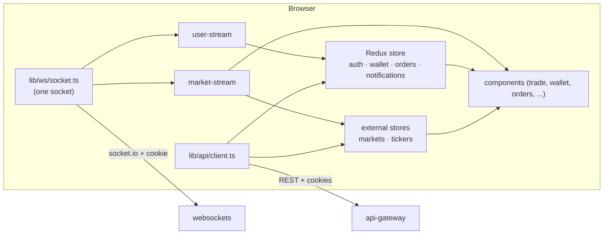

# 8. Frontend (apps/web)

Next.js App Router, React, Redux Toolkit, Tailwind, shadcn/ui, socket.io
client.

## Routes

| Group | Routes |
|---|---|
| `(landing)` | `/` |
| `(site)` | `/markets`, `/markets/[symbol]`, `/fees`, `/status` |
| `(auth)` | `/login`, `/register`, `/forgot-password` |
| `auth` | `/auth/success` (OAuth lands here) |
| `trade` | `/trade`, `/trade/[symbol]` (trading terminal) |
| `(app)` (needs sign-in) | `/dashboard`, `/wallet` (+ `deposit`, `withdraw`, `history`, `deposits/[id]`), `/orders` (+ `history`, `trades`, `[orderId]`), `/account` (+ `security`, `api-keys`, `notifications`, `preferences`) |
| `payment` | `/payment/razorpay` |

## Data layer

```
lib/api/        REST clients: client.ts (fetch + refresh), auth, market, orders, wallet, types
lib/ws/         socket.ts (one socket per tab), market-stream.ts, user-stream.ts,
                depth-book.ts, schemas.ts (zod)
lib/stores/     small external stores (useSyncExternalStore): markets/tickers, preferences
lib/trading/    order-rules.ts (client copy of server rules), valuation.ts
lib/decimal.ts  string decimal math (no floats for money)
store/          Redux: auth, wallet, orders, notifications
hooks/          use-account, use-market-data, use-orders, useRedux
```



### REST client (`lib/api/client.ts`)

- Base URL `NEXT_PUBLIC_API_URL` + `/api/v1/...`, with credentials, so the
  HttpOnly cookies are sent.
- On `401` it refreshes **once** and retries. Refresh is single-flight: all
  requests that got a `401` wait for the same refresh, because a refresh token
  can be used only once.
- After a successful refresh, `onSessionRefreshed` listeners run and the socket
  reconnects to use the new cookie.
- If the refresh fails, session-expired listeners run and the user is signed
  out.

### Socket (`lib/ws/socket.ts`)

- One socket.io connection per tab to `NEXT_PUBLIC_SOCKET_URL`,
  `withCredentials: true`, reconnect delay 0.5s → 8s.
- Connection state (`idle`, `connecting`, `connected`, `reconnecting`,
  `offline`) and the `session` event live in a small store.
- `epoch` increases on every connect. Screens re-fetch REST data when it
  changes, because events could have been missed.

### Market stream (`lib/ws/market-stream.ts`)

- Reference-counts subscriptions: many components can watch the same symbol
  with one server subscription.
- The server does not remember subscriptions, so every reconnect
  re-subscribes everything (batches of ≤ 25, ≤ 50 per socket).
- Late joiners get the last snapshot for trades, ticker and candles. For depth
  they request a resync instead.

### Depth book (`lib/ws/depth-book.ts`)

```
snapshot → replace book, seq = snapshot.seq
update   → seq' ≤ seq: duplicate, ignore
           prev == seq: apply levels (quantity "0" removes the level)
           otherwise: gap → hide the book and resync
resync   → hide the book until the next snapshot
```

Sequence numbers are compared as BigInt strings. They can restart lower after
an engine restart, always behind a fresh snapshot.

### User stream (`lib/ws/user-stream.ts`)

- Dedupes by `eventId`.
- `components/app/account-sync.tsx` is mounted once and bridges the private
  socket into Redux:
  - `balance.updated` → `wallet` slice. It keeps the highest `version` per
    asset and ignores older ones.
  - Order events → open orders, plus a short debounced REST re-fetch (REST
    stays authoritative).
  - `deposit.completed` → balance re-fetch and a notification.
  - Every authenticated (re)connect → re-fetch balances and open orders.
  - Session expired → clear state and reconnect the socket. Session refreshed
    → reconnect the socket with the new cookie.

### Order form

`lib/trading/order-rules.ts` copies the server rules (tick, step, min/max,
min notional, reservation with fee) to give instant feedback. The server
checks everything again, and its answer is what the user sees on submit.

## Deposit UI

1. `/wallet/deposit` gets a quote, then calls `init-deposit`.
2. It opens Razorpay Checkout.js with `NEXT_PUBLIC_RAZORPAY_KEY` (must be the
   same Razorpay account as wallet-service).
3. On success it calls `verify` and shows "awaiting confirmation".
4. The balance changes when the socket delivers `deposit.completed` and
   `balance.updated` (after the webhook).

## Env

| Variable | Meaning |
|---|---|
| `NEXT_PUBLIC_API_URL` | api-gateway origin (`http://localhost:5000`) |
| `NEXT_PUBLIC_SOCKET_URL` | websockets origin (`http://localhost:5005`) |
| `NEXT_PUBLIC_RAZORPAY_KEY` | Razorpay public key id. If empty, deposits show as not configured |

More detail: [`../frontend-integration/`](../frontend-integration/).
