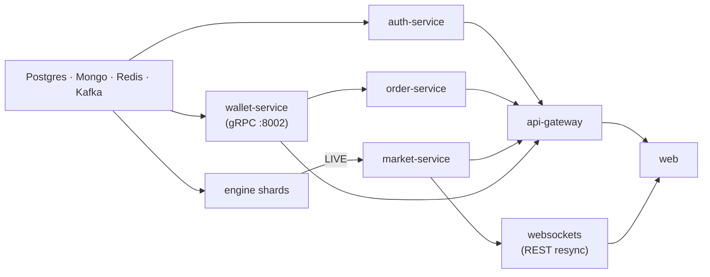

# 9. Operations

## Run locally

Needs Bun 1.3+, Node 18+, Docker.

```bash
# 1. Infrastructure: Redis, MongoDB, Postgres, Kafka (KRaft)
docker compose up -d

# 2. Dependencies
bun install

# 3. Env files
for d in apps/*/; do [ -f "$d.env.example" ] && cp -n "$d.env.example" "$d.env"; done
#   Use the SAME JWT_ACCESS_SECRET in auth, wallet, order and websockets.
#   docker-compose creates database "aurax"; the .env.example files use "aurax-v1":
docker compose exec postgres createdb -U aurax aurax-v1

# 4. Schema + seed (assets, markets)
cd packages/postgres && bun run generate && bun run migrate:deploy && bun run seed && cd -

# 5. Kafka topics
cd scripts && bun run kafka && cd -

# 6. Everything except the bots
bun run dev

# Optional: liquidity from bots (dev only)
cd apps/trading-bots && bun run dev
```

### Start order

`bun run dev` starts everything at once. The services wait for each other:



- market-service will not serve data until every engine shard is `LIVE`
  (`ENGINE_READY_TIMEOUT_MS=0` means wait forever).
- order-service needs wallet gRPC for every order. Without it, orders get
  `503`.
- websockets works without market-service, but depth resync then waits for the
  periodic Kafka snapshot.

## Environment variables

Shared rules:

- `JWT_ACCESS_SECRET` must be the **same** in auth-service, wallet-service,
  order-service and websockets (and `AURAX_DEV_JWT_SECRET` in trading-bots).
- `KAFKA_BROKERS`: comma-separated `host:port`, default `localhost:9092`.
- `PG_DATABASE_URL`: the same Postgres for wallet, order, engine and market.

| Service | Variables |
|---|---|
| api-gateway | `PORT`, `AUTH_SERVICE_URL`, `WALLET_SERVICE_URL`, `ORDER_SERVICE_URL`, `MARKET_SERVICE_URL`, `CORS_ORIGINS`, `UPSTREAM_TIMEOUT_MS`, `RATE_LIMIT_PER_MIN`, `WRITE_RATE_LIMIT_PER_MIN` |
| auth-service | `PORT`, `DATABASE_URL` (Mongo), `REDIS_HOST`, `REDIS_PORT`, `JWT_ACCESS_SECRET`, `JWT_REFRESH_SECRET`, `FRONTEND_URL`, `GOOGLE_CLIENT_ID/SECRET/REDIRECT_URI`, `GITHUB_CLIENT_ID/SECRET/REDIRECT_URI` |
| wallet-service | `PORT`, `PG_DATABASE_URL`, `JWT_ACCESS_SECRET`, `WALLET_GRPC_URL`, `KAFKA_BROKERS`, `RAZORPAY_CLIENT_ID`, `RAZORPAY_CLIENT_SECRET`, `RAZORPAY_WEBHOOK_SECRET`, `USDC_INR_RATE` (default 95.72), `OUTBOX_RELAY` |
| order-service | `PORT`, `PG_DATABASE_URL`, `JWT_ACCESS_SECRET`, `WALLET_GRPC_URL`, `KAFKA_BROKERS`, `OUTBOX_RELAY` |
| engine | `PG_DATABASE_URL`, `KAFKA_BROKERS`, `MARKETS_A`, `MARKETS_B`, `ENGINE_GRPC_HOST`, `ENGINE_GRPC_BASE_PORT`, `SNAPSHOT_STORE`, `SNAPSHOT_DIR`, `SNAPSHOT_EVERY`, `S3_*` |
| market-service | `PORT`, `PG_DATABASE_URL`, `KAFKA_BROKERS`, `MARKETS`, `ORDER_GRPC_URL`, `DEPTH_PUBLISH_LEVELS`, `DEPTH_SNAPSHOT_INTERVAL_MS`, plus optional `KAFKA_TRADES_FROM_BEGINNING`, `GRPC_TIMEOUT_MS`, `ENGINE_READY_TIMEOUT_MS`, `RECENT_TRADES_PER_MARKET`, `CANDLE_PERSIST_INTERVAL_MS`, `REPLAY_PUBLISH_MAX_AGE_MS`, `SHUTDOWN_TIMEOUT_MS` |
| websockets | `PORT`, `JWT_ACCESS_SECRET`, `KAFKA_BROKERS`, `MARKET_SERVICE_URL`, `CORS_ORIGINS`, `INSTANCE_ID`, `KAFKA_GROUP_PREFIX`, `MAX_SUBSCRIPTIONS_PER_SOCKET`, `TICKER_COALESCE_MS`, `SLOW_CLIENT_BUFFER_LIMIT` |
| web | `NEXT_PUBLIC_API_URL`, `NEXT_PUBLIC_SOCKET_URL`, `NEXT_PUBLIC_RAZORPAY_KEY` |
| trading-bots | `DATABASE_URL`, `PG_DATABASE_URL`, `AURAX_API_URL`, `AURAX_WS_URL`, `AURAX_DEV_JWT_SECRET` |

Every service has a `.env.example` with comments.

## Health and metrics

| Service | Endpoints |
|---|---|
| api-gateway | `GET /health` |
| market-service | `GET /health`, `/health/live`, `/health/ready` (engine, consumers), `/metrics` (Prometheus text) |
| websockets | `GET /health` (socket count, instance id), `/metrics` |
| engine | gRPC `GetEngineStatus` (`LIVE` / `RECOVERY`) |

## Tests

```bash
cd apps/engine && bun test          # matching rules, FOK / IOC / post-only, cancel
cd apps/order-service && bun test   # order rules, settlement against a real DB
cd apps/market-service && bun test  # candles, tickers, depth, pipeline, REST, persistence
cd apps/websockets && bun test      # depth mirror
cd apps/wallet-service && bun test  # history queries
cd apps/auth-service && bun test    # OAuth, sessions
cd apps/trading-bots && bun test
```

End-to-end: `apps/order-service/test/e2e` (`driver.ts`, `svc.sh`, `env.sh`)
runs the real stack, places orders, and finishes with `reconcileWallets`.

## Useful checks

```bash
# Is each engine shard LIVE? (market-service logs "Matching engine is ready")
curl -s localhost:5004/health/ready

# Consumer lag per group
docker exec kafka /opt/kafka/bin/kafka-consumer-groups.sh \
  --bootstrap-server localhost:9092 --describe --all-groups

# Unpublished outbox rows (should stay near 0)
docker compose exec postgres psql -U aurax -d aurax-v1 \
  -c 'SELECT topic, count(*) FROM "OutboxEvent" WHERE "publishedAt" IS NULL GROUP BY 1;'

# Engine snapshots (fs mode)
ls apps/engine/.snapshots/*/
```

## Reset everything (dev)

Order matters. If Kafka is wiped but engine snapshots are kept, the engine
detects that the snapshots are stale and rebuilds. If Kafka retention deletes
commands that a snapshot still needs, the engine refuses to start: delete the
snapshots too.

```bash
docker compose down -v           # Postgres, Mongo, Redis, Kafka data
rm -rf apps/engine/.snapshots    # engine snapshots (fs mode)
# then repeat steps 1, 4 and 5 above
```

## Scaling notes

| Component | Can run more than one? | Notes |
|---|---|---|
| api-gateway | Yes | Rate limits are per instance (in memory). Set `trust proxy` behind a load balancer |
| auth-service | Yes | State is in Mongo and Redis |
| wallet-service | Yes | One relay publishes at a time (advisory lock) |
| order-service | Yes | Replicas share the consumer group; settlement is idempotent with row locks |
| market-service | Partly | Replicas share consumer groups, but each keeps its own memory state, so REST answers can differ slightly between replicas |
| websockets | Yes | Each instance needs a unique `INSTANCE_ID`; each consumes every event |
| engine | **One process per shard** | Two shards with the same markets would both match and publish. Scale by splitting markets across shards |
| Kafka partitions | More is fine | Keys keep ordering per market / user. Today topics use the broker default |
