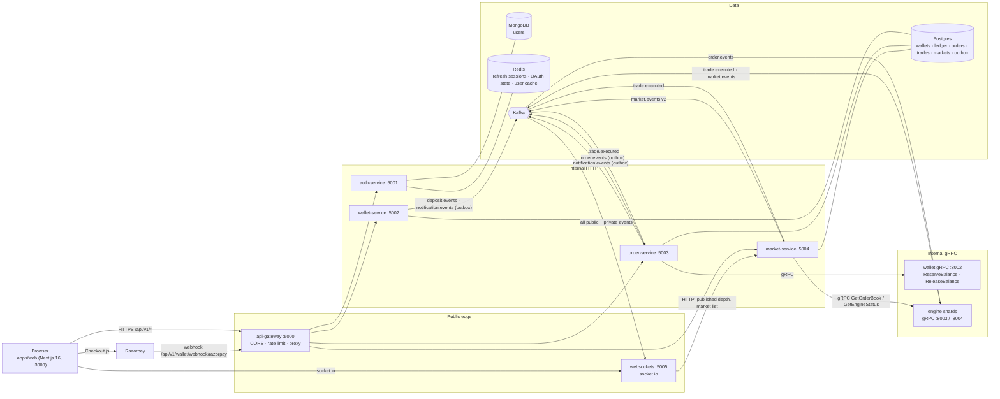
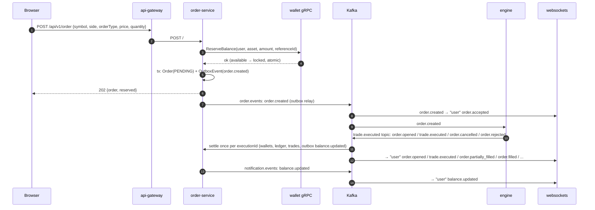
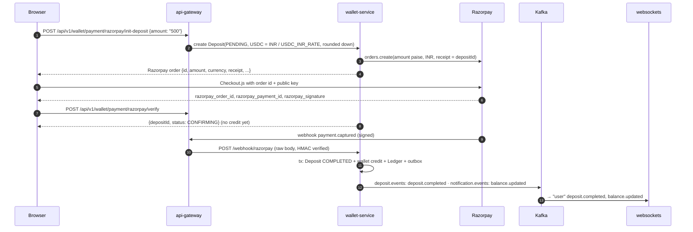
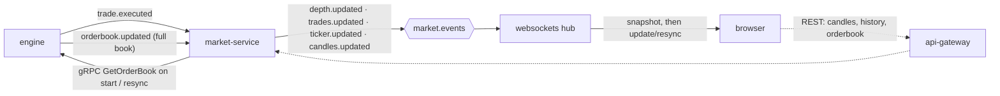

# Architecture

Verified against the code on 2026-10-26. Ports are the defaults from each
service's `config/env.ts`.

## Components

The browser only talks to **api-gateway** (HTTP) and **websockets**
(socket.io). Every other service, both gRPC servers and all data stores are
internal. The frontend must never call `:5001–:5004`, `:8002–:8004` or Kafka
directly.

| Service | Owns | Does not do |
|---|---|---|
| api-gateway | CORS, per-IP rate limits, routing `/api/v1/{auth,wallet,order,market}` | Auth checks (each service verifies the JWT itself) |
| auth-service | Google/GitHub OAuth, JWT issue/refresh/logout, user profile | Email/password login (code exists, not routed), 2FA, API keys |
| wallet-service | Balances, reservations (gRPC), Razorpay INR→USDC deposits, deposit and ledger history | Withdrawals, crypto deposits, transfers |
| order-service | Order intake, cancel, order/fill history, **trade settlement** | Matching |
| engine | In-memory books, price-time matching, sharded by market | Persistence of orders (Postgres is owned by order-service) |
| market-service | Markets, tickers, depth, public trades, candles; v2 market-data events | Private data |
| websockets | Fan-out of public market data and the caller's own private events | Accepting orders or any write |

## Order lifecycle

`202 Accepted` means only "funds reserved and command queued". Final state
comes from the private socket or `GET /api/v1/order/:orderId`.

## Deposit (Razorpay)

Only the signed webhook credits funds. The client-side `verify` call can never
credit or downgrade a deposit.

## Public market data

## Sources of truth

| Data | Authoritative store | Live projection |
|---|---|---|
| Balances | Postgres `Wallet` (+ `Ledger` for every movement) | `balance.updated` (keep highest `version`) |
| Orders and fills | Postgres `Order`, `Trade` (order-service) | private socket order/trade events |
| Order book | engine memory (snapshots on fs/S3) | market-service mirror → `depth` channel |
| Public trades, candles, tickers | Postgres `MarketTrade`, `Candle` + market-service memory | public socket channels |
| Users | MongoDB | — |
| Sessions | Redis `session:<refreshToken>` | — |

## Delivery guarantees

- Kafka delivery is at-least-once everywhere. Every event has a deterministic
  `eventId`, and every consumer with side effects is idempotent.
- DB changes that emit events use a transactional outbox (`OutboxEvent` +
  `OutboxRelay` in `@repo/pg`).
- WebSocket clients must deduplicate by `eventId` (private), `sequenceNumber`
  (depth), `tradeId` (trades) and `version` (balances). See
  [websocket-api.md](websocket-api.md).
